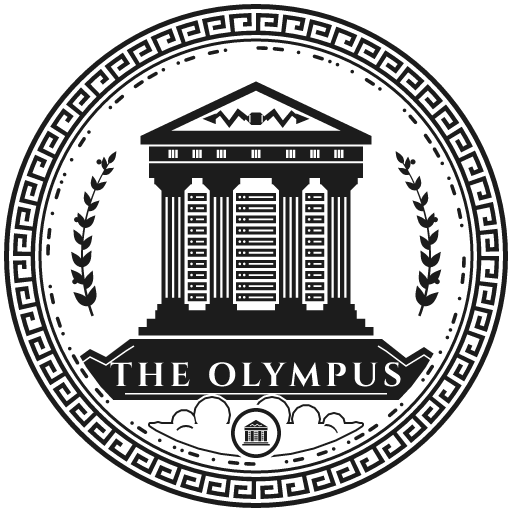

# The Olympus

The visual identity of a private server: a heraldic crest in which a temple on
Mount Olympus is the server, and every service is a god with a domain.



## Documentation

- [Brand book](docs/the-olympus-brand-book.pdf) (PDF, 12 pages): the identity
  at a glance, for sharing and printing.
- [Design system](docs/02-design-system.md): construction, palette,
  typography, tiers, clear space, print rules and files.
- [Service catalogue](docs/03-catalog.md): every service's crest, its
  patron god, and how to add a new one.
- [The Atelier](docs/04-generator.md): the web app for making and exporting
  new designs.
- [3D printing](docs/05-3d-printing.md): medallions, nameplates, coasters,
  a marble lithophane, tokens and a desk stand, as validated STL and 3MF with
  OpenSCAD sources.
- [Stickers](docs/06-stickers.md): die-cut stickers and sheets, as layered
  PDF and SVG with a separate cut path.
- [The site on your server](docs/07-self-hosting.md): everything above as one
  static website — build it, or run it with Docker.
- [Creative directions](docs/01-creative-directions.md): how the mark was
  arrived at.

## Master files

Production files are in [`assets/master/`](assets/master/):

- SVG for every tier (crest, emblem, seal), in both editions (fine, print)
  and on every ground;
- PNG at the sizes each tier is meant for;
- `favicon.ico`.

Each service has the same set, plus name lockups, in
[`assets/services/<id>/`](assets/services/).

## The website

```sh
npm run app            # the site, with live reload, at http://localhost:5173
docker compose -f deploy/docker-compose.yml up -d --build   # on a server, port 8080
```

One static site with the Atelier, the catalogue, the guide and every
download. See [the site on your server](docs/07-self-hosting.md).

## Making a new logo

In the browser:

```sh
npm run app            # the Atelier, at http://localhost:5173
```

Name the service, pick its category (and so its god), preview it on every
surface and size, save it, and export the full asset pack. See
[the Atelier](docs/04-generator.md).

From the command line:

```sh
npm run service -- add --name "Vaultwarden" --category security
```

This writes `catalog/services/vaultwarden.json`, picks the category's god
(here Athena), and builds every file. See the
[service catalogue](docs/03-catalog.md) for the options.

## Working on it

Requires Node.js 24 or later, which runs the TypeScript sources directly.

```sh
npm install
npm test               # locks the marks: geometry, border, palette, printability, catalogue
npm run build:master   # regenerate assets/master/
npm run service -- build   # regenerate assets/services/ and the catalogue
npm run app            # the Atelier (web app), with live reload
npm run app:build      # the Atelier as a static site in app/dist/
npm run model -- master   # printable models into manufacturing/3d/
npm run sticker -- master # stickers into manufacturing/stickers/
npm run build:docs     # regenerate the design-system boards
```

Every file is generated from the geometry in `src/`. The same configuration
always produces the same mark.

## Licences

Cinzel, Jost and JetBrains Mono are used under the SIL Open Font License 1.1.
