# The Olympus — Phase 1 · Creative Direction: The Pantheon Crest

> Round 2. Round 1's minimal marks ([archived here](01a-creative-directions-round-1.md))
> were too abstract to say what the system *is*. This direction answers two
> questions: what the system is (a home for many services), and what it runs on
> (real hardware), as a heraldic crest.
>
> **Current direction: Version A2.** This is Version A (the Name Plinth) with
> clouds, a logo slot and a new border; it is described
> first, below. The rest of this document records Version A as it stood before
> those additions, and Version B ("The Inscribed Temple"), which was explored
> and set aside.

## Version A2 — above the clouds

The temple, the god in the cella, the laurel and **THE OLYMPUS** cut into the
mountain plinth are unchanged from Version A. Three things are new:

- **Clouds.** The mountain now rises out of a bank of engraved clouds: the
  realm stands above the cloud. The clouds stay inside the frame and below the
  plinth's lettering.
- **A logo slot.** A framed medallion rests on the clouds in the exergue.
  - **Default content:** the service's seal, the same icon as its favicon.
  - **External logos:** a service's own application logo can sit there
    instead, reduced to a single grey and kept inside its own ring. That keeps
    any third-party mark clearly separate from the crest.
  - **Size:** the medallion is Ø50 on the 512 artboard, with a Ø40 safe area
    for the logo.
- **A new border.** The Greek key and a bead-and-reel astragal now follow
  the house's own rhythm rather than a stock repeat, and the crest carries no
  date anywhere, so it stays timeless.

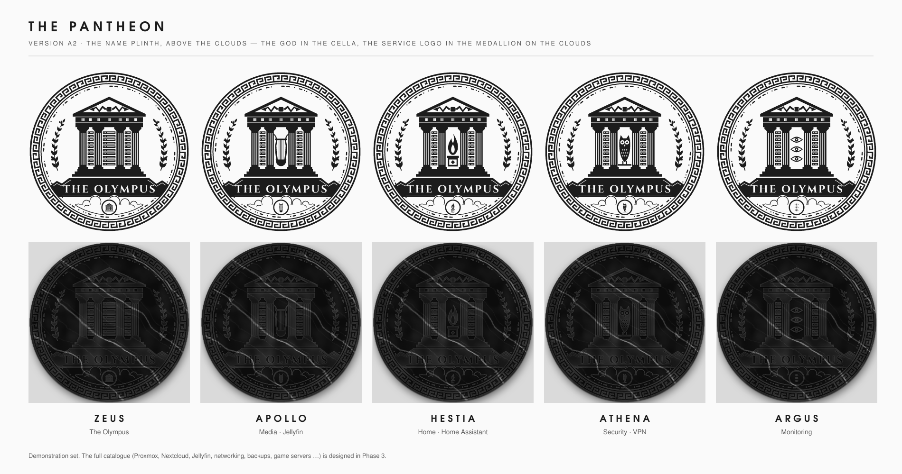

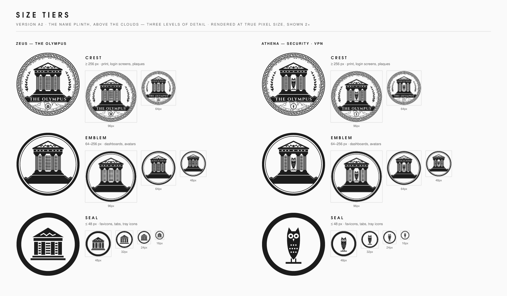

The emblem and seal tiers are unchanged from Version A. The border detail and
the clouds only exist at crest size, where they can be seen.

## A2 alternatives and print editions

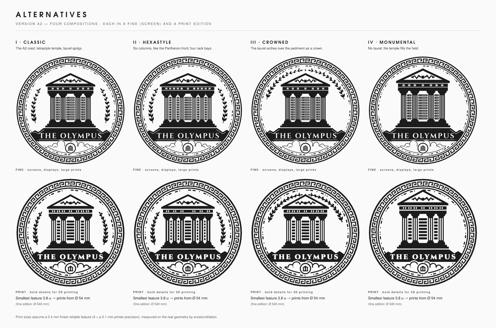

Four compositions of the same crest, each in two detail editions:

| Composition | Arrangement | Character |
|---|---|---|
| **I · Classic** | Tetrastyle temple, laurel sprigs | The A2 crest as designed |
| **II · Hexastyle** | Six columns, four rack bays | Closer to the Parthenon front; more "server" |
| **III · Crowned** | Laurel arching over the pediment | More ceremonial; the sides open up |
| **IV · Monumental** | No laurel, larger temple | The most architectural and the boldest |

**Fine edition:** the screen crest. Use it for displays, login screens and
large prints.

**Print edition:** the same composition with every stroke and every gap
widened to a printable minimum:
- **Border:** heavier rim and inner rule. The Greek key is a little wider,
  and the beads are larger.
- **Temple:** two flutes per column, plain rack bars, two-slot triglyphs, and
  a slightly taller pediment so the thunderbolt fits with clearance.
- **Lettering:** the name is set in Cinzel Black and emboldened by 0.62 units.
  That balances its hairlines against the counter of the P.
- **Clouds and medallion:** bolder cloud lines, and a bold medallion glyph.

### How printability is measured

`src/print/printcheck.ts` tests the real geometry by morphology, not by eye.

- **Too thin:** an *opening* (shrink, then grow) removes any rib, bead or
  hairline thinner than the feature size.
- **Too narrow:** a *closing* (grow, then shrink) fills any slot, counter or
  hole narrower than it.
- **Not counted:** losses at sharp tips and in acute crevices. These print as
  slightly rounded corners.
- **Always counted:** whole islands or holes that vanish.

The largest feature size at which nothing is lost is the crest's **minimum
feature**. The minimum printable diameter follows from it:
`Ø_min = feature_mm × 504 / minimum_feature`.

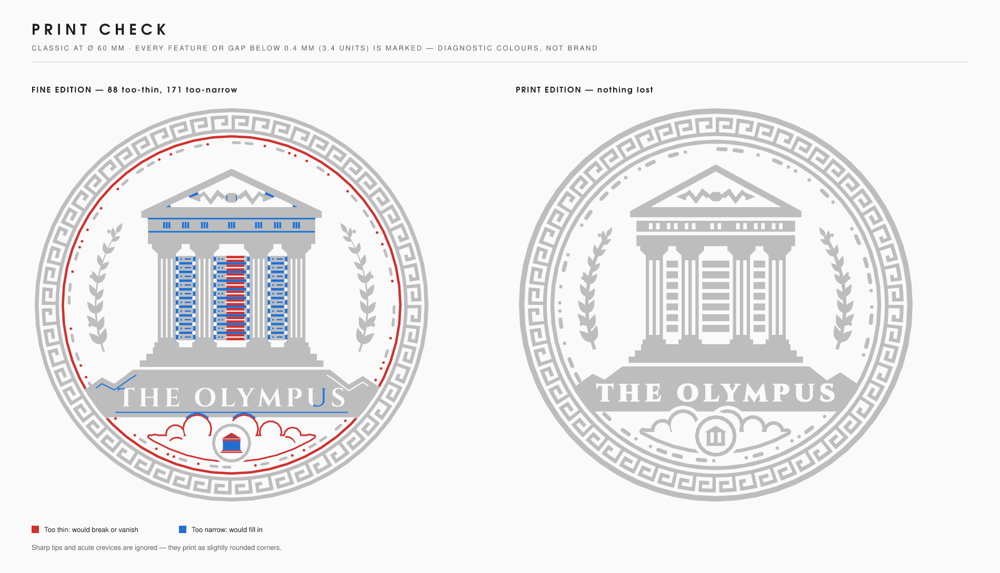

| Edition | Minimum feature | Ø min at 0.3 mm | Ø min at 0.4 mm | **Ø min at 0.5 mm** (0.4 mm nozzle) |
|---|---|---|---|---|
| Print (all four compositions) | 3.8 units | 40 mm | 54 mm | **67 mm** |
| Fine (all four compositions) | 0.4 units | 400 mm | 540 mm | 670 mm |

The house printer is a filament printer with a 0.4 mm nozzle. Its finest
reliable feature is about **0.5 mm**, so the Print edition prints from
**Ø 67 mm**. Every Print edition is limited by its lettering, so all four
compositions print from the same size.

**Scope and limits:**
- This check covers the **2D artwork**: what survives at a given size.
  Relief height, draft, supports and the printable mesh (STL / 3MF) belong
  to Phase 6.
- Print-ready vectors of the chosen composition are in `assets/master/svg/`
  (`the-olympus-crest-print*.svg`). Each is one clean polygon path, exactly
  the geometry that was checked.
- The Print edition currently covers the master crest. The cella symbols of
  the other gods (e.g. the lyre's strings) need print versions of their own,
  which come with the Phase 3 catalogue.

---

## Version A — the Name Plinth (before A2)

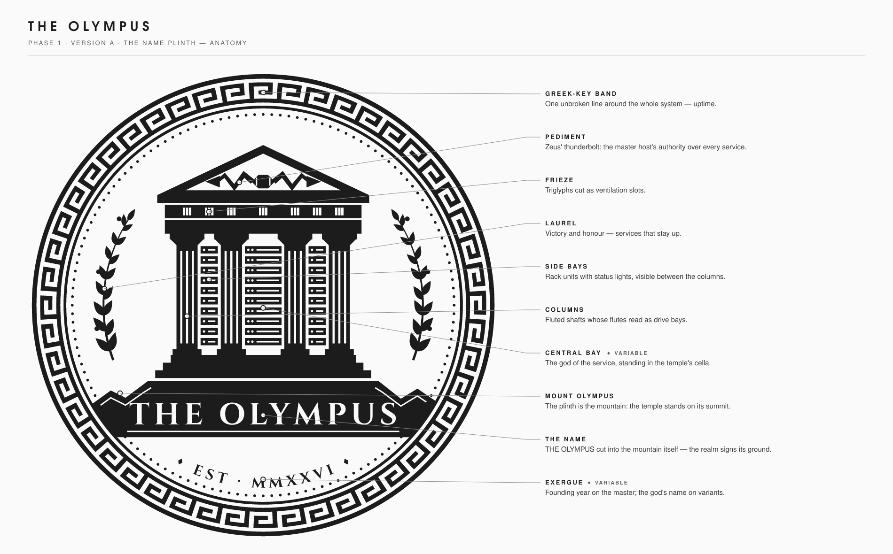

## The idea

**My server is my own Olympus, and every service on it is a god with a domain.**

The crest is an ancient coin. At its centre is a temple standing on the
summit of Mount Olympus. Look closely and the temple is a server:

- the **frieze triglyphs** are ventilation slots,
- the **fluted columns** read as drive bays,
- between the columns, the **side bays** hold rack units with status lights,
- and in the **central bay**, where a Greek temple keeps the statue of its god,
  stands the god of the service.

The **pediment** always carries Zeus' thunderbolt, the authority of the master
host over everything it runs.

**The name is part of the mountain.** The temple stands on a solid plinth
whose upper edge is the silhouette of Olympus: a plateau under the temple,
and a peak and a col on each slope. **THE OLYMPUS** is cut out of that plinth
at full width, reading horizontally like the bar of a seal. The realm signs
its own ground. An engraved contour traces each slope. The mountain stays in
the story, but it takes only the space the name already needs.

Around it, coin conventions do real work:

- The **Greek-key band** is one unbroken line around the whole system: uptime.
- The **laurel** is honour earned by services that stay up.
- The **exergue** (the coin's lower field) carries the founding year on the
  master and the god's name on each variant.

*Revision note:* the first crest set the name in a thin arc inscription and
gave the lower third to a large black mountain with clouds. The name read as
a caption rather than the brand, and the mountain dominated. Both were
replaced by the name plinth.

## The pantheon — how variants work

The temple, name plinth, rim, key band and laurel are **fixed**. A service
changes exactly two things: the **god in the central bay** and the **exergue
label**. That is the only slot the generator will
expose, which is what keeps a large family consistent.

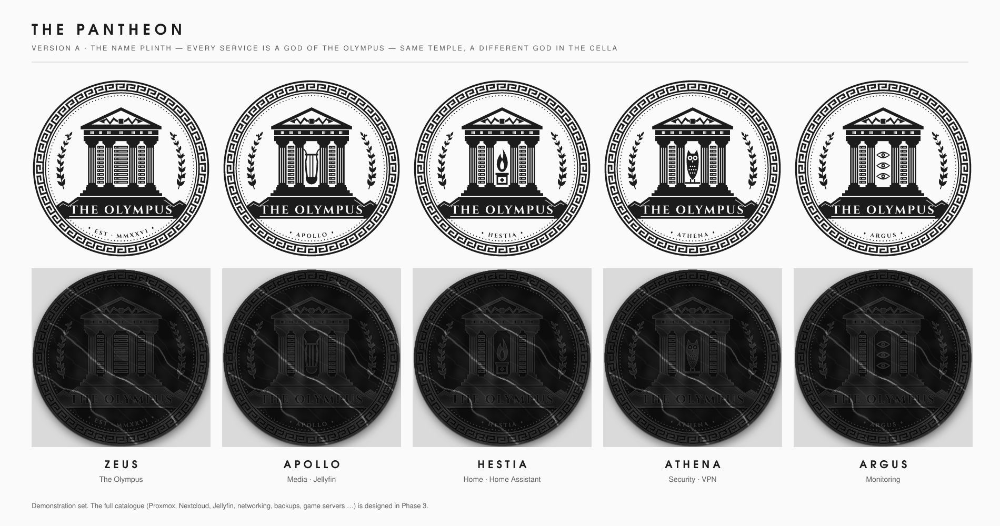

Demonstration set (built):

| God | Domain | Symbol in the cella | Why |
|---|---|---|---|
| **Zeus** | The Olympus (master) | Rack units in every bay | The master *is* the whole server |
| **Apollo** | Media · Jellyfin | Lyre | God of music and the arts |
| **Hestia** | Home · Home Assistant | Flame on the household altar | Goddess of the hearth and the home |
| **Athena** | Security · VPN | Owl on a perch | Wisdom, strategy and defence |
| **Argus** | Monitoring | Three watching eyes | Argus Panoptes, the hundred-eyed watchman |

Proposed for the full catalogue (Phase 3, open to your changes):

| Service | God | Symbol | Why |
|---|---|---|---|
| Proxmox VE | **Atlas** | Celestial sphere | He holds up the world; the hypervisor holds up every VM |
| Networking | **Iris** | Rainbow arcs | The messenger whose bridge connects realms |
| Reverse proxy | **Hermes** | Winged staff | God of roads and crossings; routes every traveller |
| NAS / Storage | **Hades** | Key | Lord of the vault below; nothing is lost |
| Backup | **Kronos** | Hourglass | Time itself: snapshots |
| Containers | **Poseidon** | Trident | Lord of the sea and its cargo |
| Nextcloud | **Nephele** | Spiral cloud | The cloud nymph: your own cloud, brought up to Olympus |
| Web services | **Arachne** | Web | The weaver of the web |
| Game server (general) | **Nike** | Wings of victory | Victory in every contest |
| Minecraft | **Hephaestus** | Hammer and anvil | The divine craftsman and miner |
| Dedicated multiplayer | **Ares** | Crested helmet | The god of contest and combat |
| Community hosting | **Dionysus** | Kantharos (cup) | Festival and community |

These are original symbols drawn in the crest's own style. No third-party
logo is copied or imitated.

## Materials

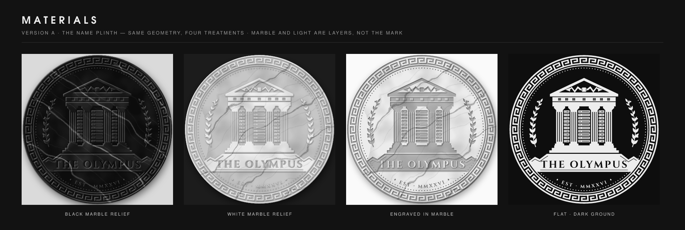

The geometry is a single clean vector. Black and white marble relief, the
engraved medallion and the flat versions are all treatments layered on top.
The marble veining is seeded, so it is identical on every render. These are
screen presentations: real marble-like objects are handled in the
manufacturing phases (Phases 5–6).

## Size tiers

A crest this rich cannot be a 16 px favicon, so the identity is defined at
three levels of detail. Every tier keeps the same god.

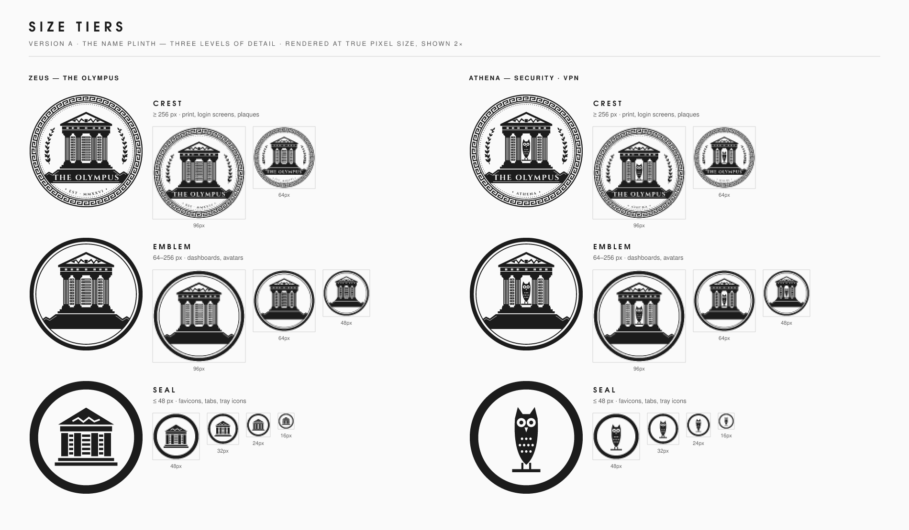

| Tier | Use | Contents |
|---|---|---|
| **Crest** | ≥ 256 px: print, login screens, plaques, stickers | Everything |
| **Emblem** | 64–256 px: dashboards, avatars | Rim, temple-server, god, plinth (no lettering) |
| **Seal** | ≤ 48 px: favicons, tabs, tray icons | Heavy rim + one bold symbol: the temple-server (master) or the god (variants) |

The true-pixel tests show the emblem holds at 48 px and the seal at 16 px.
Because the name is set horizontally on the plinth, **THE OLYMPUS** is still
legible in the crest at 96 px. Below that, the emblem and seal take over.

## Version B — The Inscribed Temple (set aside)

Built from an annotated sketch of Version A, then revised. In this version
the temple spells its own name instead of standing on it.

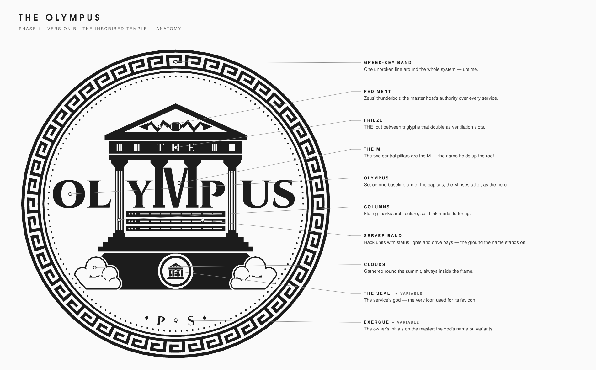

- **THE** is cut into the frieze, between triglyphs that still read as vents.
- **The M is the two central pillars.** They hang from the capitals like
  the columns they replace, carry the roof, and end in column bases on the
  baseline. A V (thick left stroke, thin right, as in Roman capitals) hangs
  between them. The M is taller than the other letters: it is the hero of
  the word and has classical proportions, about as wide as it is tall.
- **O L Y P U S** are set in Cinzel Black on the M's baseline. Y and P stand in
  the side bays; O L and U S stand outside the temple.
- **One stroke weight.** The pillars are drawn at Cinzel Black's measured stem
  weight for that cap height, so the built M and the typeset letters match.
- **Fluting means architecture, solid ink means lettering.** The outer columns
  stay fluted the whole way down, so they never read as an extra "I".
- **The server band:** below the name, three rack units with status lights and
  drive bays span the colonnade. The name stands on the servers.
- **The temple is identical for every service.** The god becomes a seal
  medallion on the plinth. The medallion is literally the service's seal-tier
  icon, so the favicon in a browser tab is the badge on the crest.
- **Engraved clouds** gather round the plinth: a scalloped contour, with seam
  lines only where one billow overlaps another. They stay inside the frame and
  never touch the Greek-key band. The plinth ends inside them.
- **The exergue** carries the owner's initials on the master (default
  `P · S`) and the god's name on variants.
- **Changes from the sketch:**
  - The laurels were removed: O L and U S now occupy their space.
  - The clouds were redrawn as engraved banks rather than cartoon puffs.

*Revision note:* the first build of B set OLYMPUS *over* the colonnade with a
white keyline. It read as text laid over a picture, not as part of the
building, and at 64 px the letters merged into the columns. The rebuild makes
the M structural, which fixed both problems.

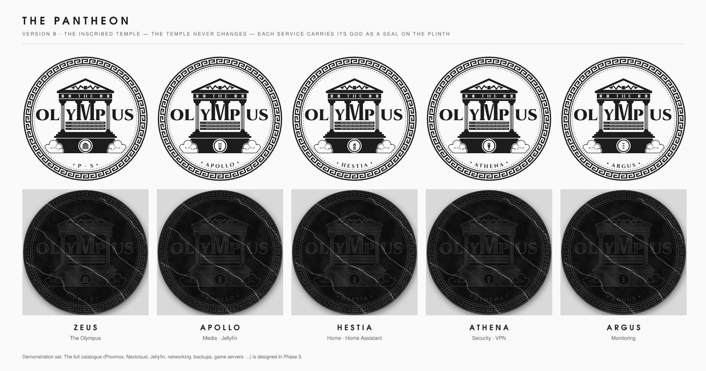

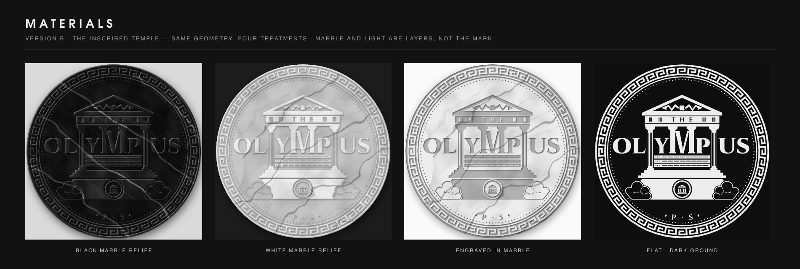

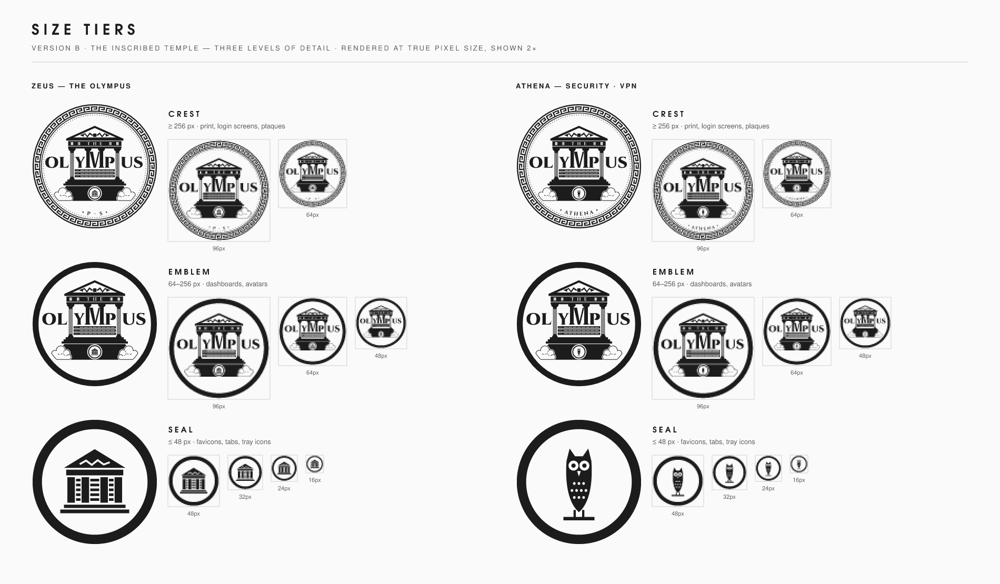

## A or B (resolved: A, developed into A2)

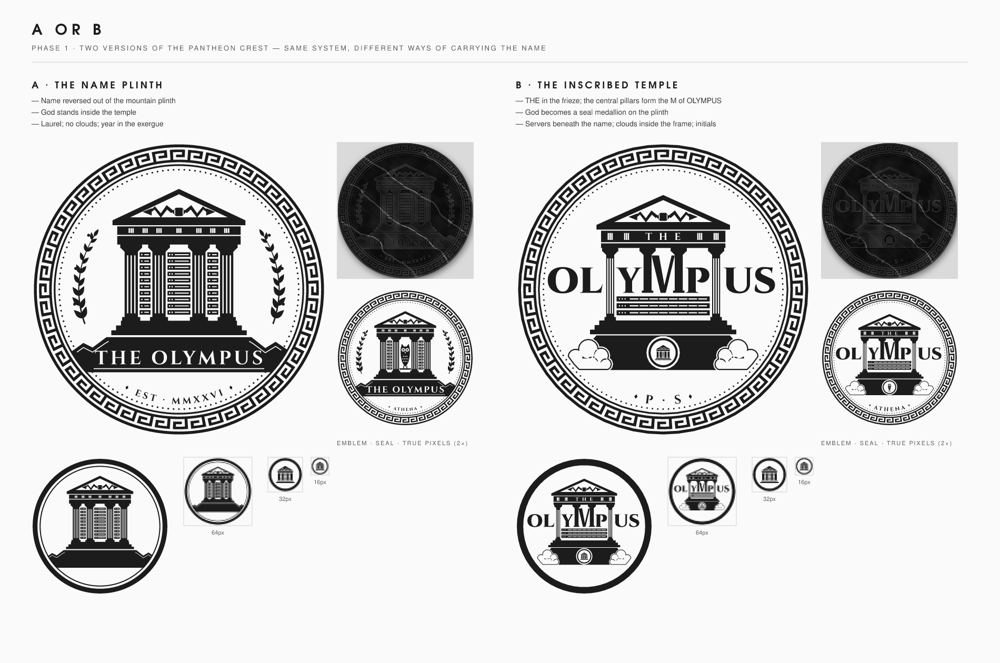

| Aspect | A · The Name Plinth | B · The Inscribed Temple |
|---|---|---|
| **The name** | Reversed out of the mountain plinth; very clean and legible | Built into the architecture (the M is the pillars); more distinctive, more "logo" |
| **The god** | Inside the temple, as its cult statue | On a seal medallion: the same icon as the favicon |
| **Family consistency** | Temple changes per service (central bay) | Temple never changes; only the seal and exergue do |
| **Atmosphere** | Calm, institutional; laurel | Monumental: clouds round the summit, servers under the name |
| **Personal touch** | Founding year | Owner's initials |
| **Emblem at 64 px** | Holds well: temple and plinth stay distinct | Holds well: OLYMPUS is still legible, even at 48 px |
| **Crest at 96 px** | Name still legible | Name still legible; it is the largest element |

Both versions share the same seal tier, treatments and pantheon logic, so
features can also be mixed between them.

## Known refinements for Phase 2

- **Seal glyphs:** the god symbols are currently the cella drawings enlarged.
  Seal-specific versions need heavier strokes (the lyre's strings vanish at
  16 px).
- **Plinth:** tune the peak/col rhythm optically, and consider whether the
  engraved contour should also run beneath the lettering.
- **Cella symbols:** apollo's lyre arms want more curve; a few symbols want
  slightly more weight to match the columns.
- **Laurel:** the leaf rhythm and berry placement need optical tuning.
- **Lettering:** Cinzel Bold is the working inscription face (OFL). It is
  converted to vector outlines, so exports never depend on an installed font.
- **Line weights:** define a minimum feature size per tier for printing and
  3D work, and check every element against it.

## Reproducing

The exploration scripts that produced the boards in this document are kept
outside the repository. The boards themselves are in
`docs/creative-directions/`. The chosen master is built from `src/`: see the
[design system](02-design-system.md).
