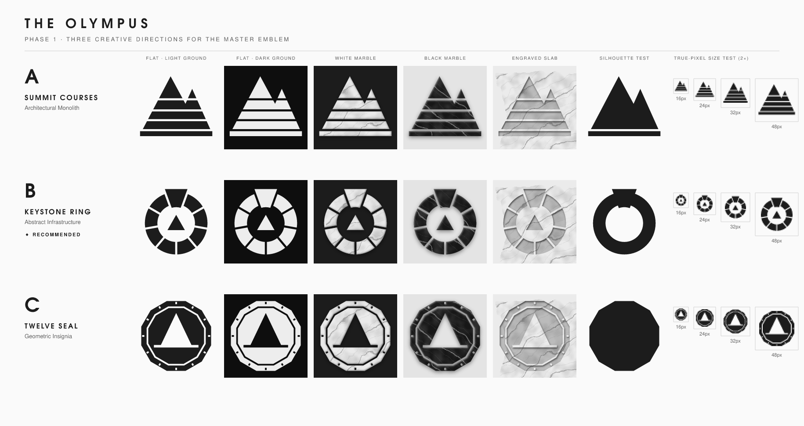
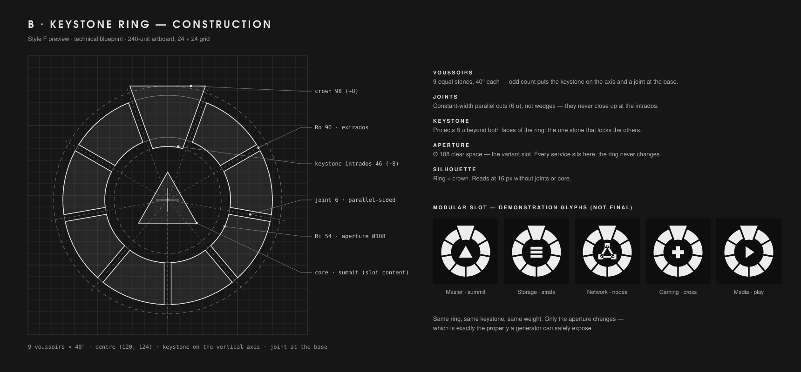

# The Olympus — Phase 1 · Round 1 · Creative Directions (not selected)

> Superseded by [Round 2 — The Pantheon Crest](01-creative-directions.md). Round 1 was judged too
> minimal: it did not express what the system is. Kept as a record of the exploration.

Three genuinely different directions for the master emblem of the private
server ecosystem, each built as real vector geometry, tested in flat,
marble and engraved treatments, as a bare silhouette, and at true pixel sizes.

The name sets the theme. Mount Olympus is the mountain above the clouds, where
the gods kept their own house. A self-hosted server is the same idea: your own
house, above the public cloud. Marble, carved stone and Greek architecture
follow from it naturally. The challenge is to use them without falling into
temple or bank-building clichés.

---

## A — Architectural Monolith · "Summit Courses"

**Concept.** The Olympus massif, a main summit with a lower shoulder, is cut
into horizontal stone courses and set on a plinth. It reads as a mountain and,
at the same time, as a built monument.

**Symbolism.** The courses are the layers of the stack, from metal through
hypervisor and containers to services. The plinth is the foundation you own.
The courses get thicker toward the base, like geological strata.

**Strengths**
- Immediately legible and calm; the summit carries the mark down to 16 px.
- The best direction for physical production: courses become stepped layers
  in a 3D print, and stacked plates for laser-cut or multi-part badges.
- Strong horizontal rhythm that pairs naturally with a wide wordmark.

**Weaknesses**
- Mountain-with-stripes is a crowded territory (outdoor brands, travel apps).
  The silhouette is the least ownable of the three.
- No natural place for application symbols. A variant would have to recolour
  or re-cut a course, which changes the master geometry or reads as a mere
  label change.
- The asymmetric shoulder is hard to keep balanced in square avatars.

**Digital suitability:** good · **Physical suitability:** excellent

---

## B — Abstract Infrastructure · "Keystone Ring" ◆ recommended

**Concept.** Nine stone voussoirs form an **O**. In an arch, every stone
carries load and none stands alone. One of them, the **keystone**, rises
slightly above the ring and sinks slightly into it. That is the stone that
locks the structure together, and it also reads as the summit on the horizon.
The open centre, the *aperture*, is the private space the system protects.

**Symbolism**
- **Ring / O:** Olympus; a closed, self-contained system you own end to end.
- **Voussoirs:** interdependent services. Remove one and the arch fails;
  together they bear any load.
- **Keystone:** the core infrastructure that holds everything in place, and
  the summit: the one element above the line.
- **Aperture:** the sanctum. In the master it holds a small summit; in every
  service variant it holds that service's symbol.

**Strengths**
- **Most ownable silhouette:** a heavy ring with a trapezoidal crown. It is
  recognisable as a bare silhouette, without joints or core.
- **Built-in modularity.** The ring, keystone, joints and stroke weight never
  change. Only the aperture changes. That gives a generator exactly one
  well-defined slot to expose, which is what keeps dozens of variants from
  drifting (see the slot demonstrations above).
- **Every element is structural.** Each joint and the keystone have a reason
  to exist; there is no decoration.
- **Marble at its best:** separate stones let veining run through each block
  differently, so it reads like real masonry.
- **Physically excellent:** each voussoir becomes a raised island on a backing
  plate (3D print, CNC, engraving), and the die-cut contour is a clean circle
  plus crown.

**Risks, and how they are handled**
- *Segmented rings can resemble loading spinners.* Nine thick stones (the
  ring is 40 % of the radius) and the keystone break that reading. Spinners
  are thin, even, and have no crown.
- *Ring plus crown can echo a gem setting.* The keystone is kept low (+8 u)
  and flat-topped, and it projects inward too, so it reads as architecture,
  not jewellery.
- *Joints fill in below about 24 px.* Phase 2 will define a small-size tier:
  joints are dropped and the ring and keystone are kept solid. The silhouette
  test shows this still reads.
- *Separate stones mean disconnected islands.* This is fine on a backing plate
  or sticker. Free-standing objects (keychain, wall cut-out) need a connected
  variant; Phase 5 will define it.

**Digital suitability:** excellent · **Physical suitability:** very good

---

## C — Geometric Insignia · "Twelve Seal"

**Concept.** A dodecagonal medallion, one facet for each of the twelve
Olympians, with an engraved inner channel and twelve rim marks like a
precision dial. In the centre, the summit stands on a horizon, cut as
negative space.

**Symbolism.** Permanence, authority and precision, like a mint stamp or an
instrument bezel. The summit on the horizon is the private peak above the
cloud.

**Strengths**
- The most "object-like": it looks like a coin, seal or rack badge already.
- Excellent for stickers and engraved plates; the rim gives a natural border.
- Formal and ceremonial, suited to certificates or boot splash screens.

**Weaknesses**
- **Fails the small-size test first.** The rim marks and channel disappear by
  32 px, leaving a polygon with a triangle in it.
- The silhouette is close to a circle; at small sizes it is a generic badge.
- The large negative triangle dominates and drifts toward warning-sign
  territory. The horizon was added precisely to keep it from reading as the
  "eject" glyph.
- Variants can only change the central device, which then competes with an
  already busy frame.

**Digital suitability:** fair · **Physical suitability:** excellent

---

## Evaluation

Scored 1–5 against the brief's quality criteria.

| Criterion | A · Summit Courses | **B · Keystone Ring** | C · Twelve Seal |
|---|:-:|:-:|:-:|
| Distinctive, ownable silhouette | 2 | **5** | 3 |
| Legibility at 16–32 px | 4 | **3** → 4 with small-size tier | 2 |
| Supports a modular variant system | 2 | **5** | 3 |
| Depth of symbolism | 3 | **5** | 4 |
| Sticker / 3D manufacturability | 5 | **4** | 4 |
| Avoids category clichés | 2 | **4** | 3 |
| **Total** | 18 | **26** | 19 |

## Recommendation

**Develop direction B, the Keystone Ring, into the master identity.**

It is the only direction where the system itself is part of the logo. The
ring is the immutable identity, and the aperture is the one sanctioned place
for change. That matches what the brief asks of the generator: real
geometric variants, with the master silhouette protected by construction.

The best ideas from the other two directions carry over:
- **From A:** the stacked-course logic becomes the 3D manufacturing language.
  Voussoirs are raised in layers, and plinth-style backing plates are used for
  desk and rack editions.
- **From C:** the seal frame becomes an optional *badge* layout for stickers
  and equipment plates, wrapping the ring rather than replacing it.

## Open points for Phase 2

1. **Master core:** keep the small summit in the aperture (current), or leave
   the master's aperture empty and reserve the slot purely for services.
   Recommendation: **keep the summit**, so the master is a complete member of
   its own family.
2. Lock the proportions (9 stones, Ro 90 / Ri 54, joint 6, keystone ±8)
   against optical tests at every size tier, and tune the keystone flare.
3. Define the small-size tier (no joints below 24 px) and the badge frame.
4. Wordmark: geometric, widely tracked capitals (the boards use URW Gothic as
   a stand-in until typography is specified).

---

### Reproducing these assets

The exploration scripts that produced these boards are kept outside the
repository; the boards are in `docs/creative-directions/`. All of them were
generated deterministically from code, with seeded marble veining.

Marble, bevel and engraving are screen presentation effects (SVG filters),
not manufacturing data. Physical marble appearance is addressed in Phase 5.
