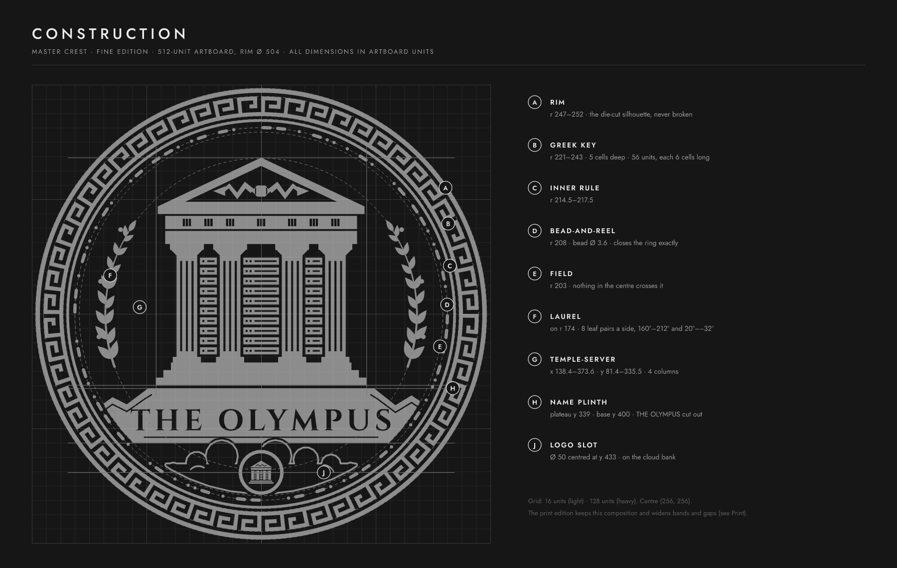
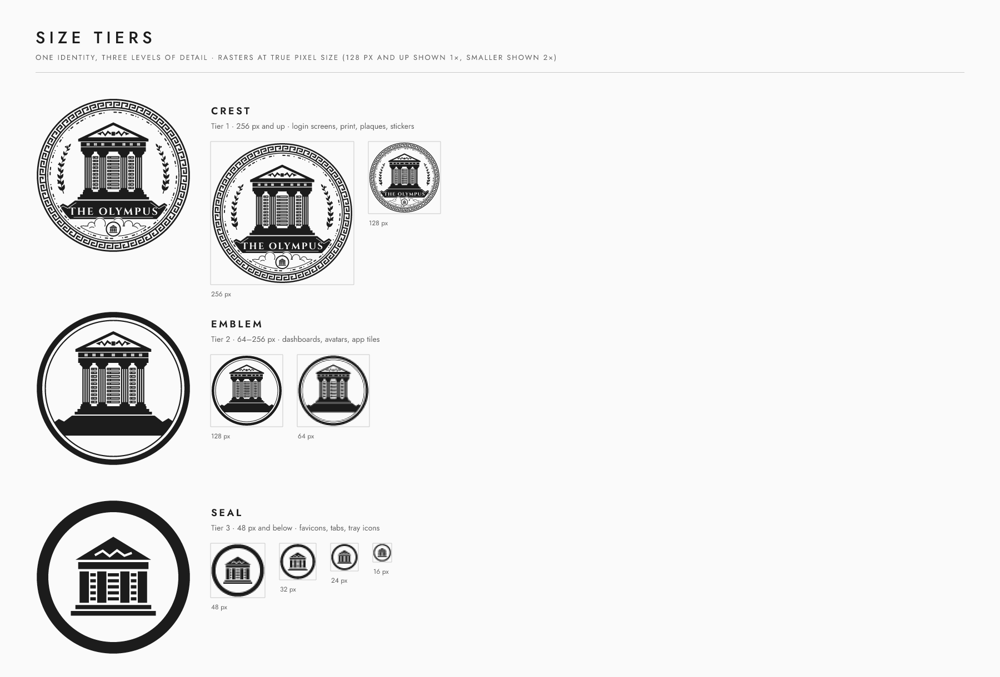
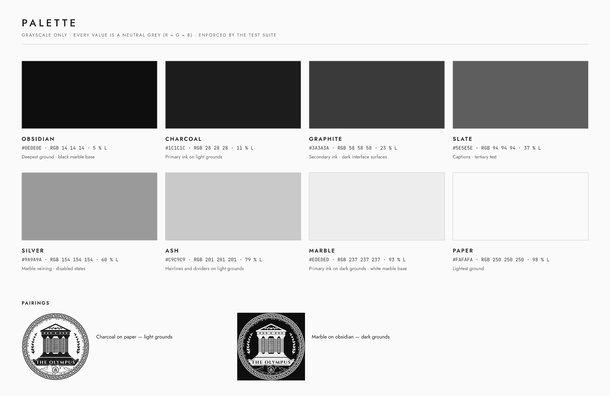
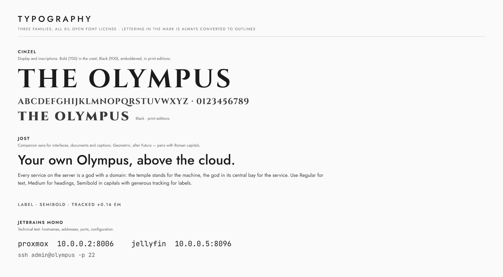
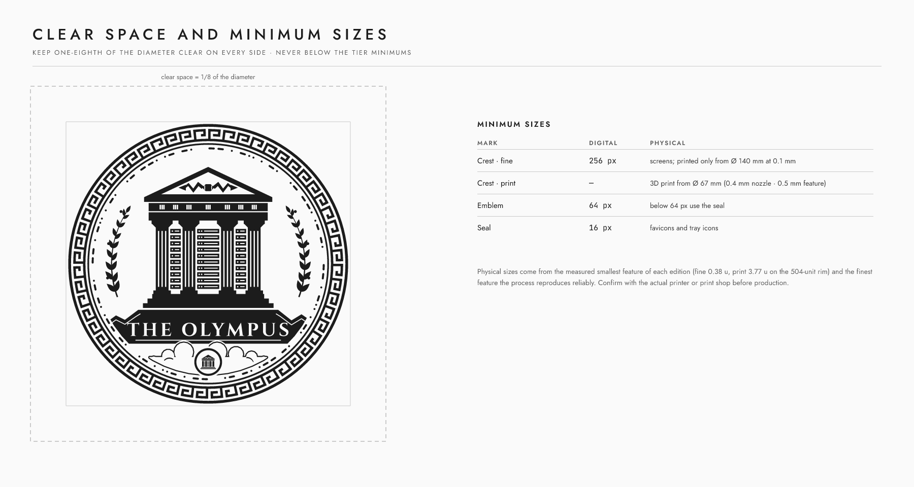
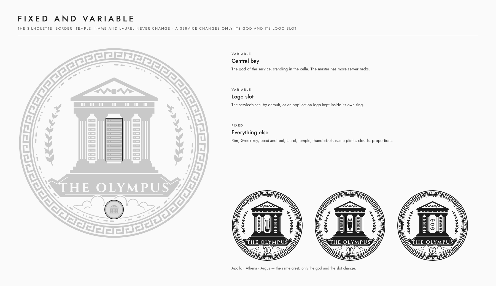
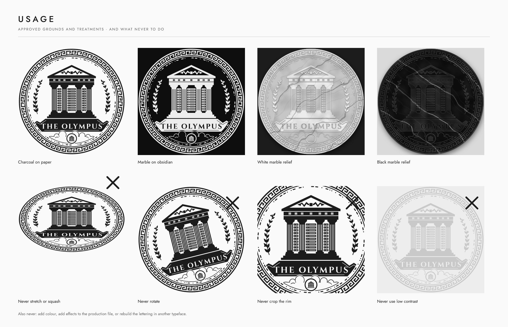

# The Olympus — Design System

The master identity of The Olympus: a private server presented as the
house of the gods. This document is the specification. The geometry itself
lives in `src/geometry/` and is the single source for every file. Section 11
lists the scripts that rebuild the boards and assets in this document.

Background and the creative rationale are in
[01 · Creative directions](01-creative-directions.md).

---

## 1. The mark

A heraldic coin. At its centre stands a temple that is a server:

- The **pediment** carries Zeus' thunderbolt, the authority of the master host.
- The **frieze triglyphs** are ventilation slots.
- The **fluted columns** read as drive bays.
- The **bays between the columns** hold rack units with status lights.
- The **central bay** holds the god of the service. On the master, it holds
  more servers.

The temple stands on **Mount Olympus**: a plinth whose silhouette is the
mountain, with **THE OLYMPUS** cut out of it. Below the plinth, the mountain
rises out of **engraved clouds**. A **medallion** resting on the clouds is the
logo slot.

The **border** is classical ornament: a running Greek key and a
bead-and-reel astragal. Both follow the house's own rhythm, set in
`src/brand/identity.ts`, rather than a stock repeat.

## 2. Construction



All dimensions are in units of the 512 × 512 artboard, centred at (256, 256).
These are the dimensions of the Fine edition.

| Key | Element | Dimensions |
|---|---|---|
| A | Rim | r 247–252 · the outer silhouette, never broken or cropped |
| B | Greek key | r 221–243 · 5 cells deep · 56 units, each 6 cells long |
| C | Inner rule | r 214.5–217.5 |
| D | Bead-and-reel | r 208 · bead Ø 3.6 · sized to close the ring exactly |
| E | Field | r 203 · nothing in the centre crosses it |
| F | Laurel | on r 174 · 8 leaf pairs per side, at 160°–212° and 20°–−32° |
| G | Temple-server | x 138.4–373.6 · y 81.4–335.5 · four columns, shafts 22 wide |
| H | Name plinth | plateau y 339 · base y 400 · ends at the field |
| J | Logo slot | medallion Ø 50 at y 433, resting on the cloud bank |

## 3. Tiers and editions



The identity has **three tiers**, each with its own level of detail:

| Tier | Use | Contents |
|---|---|---|
| **Crest** | 256 px and up · login screens, print, plaques, stickers | Everything |
| **Emblem** | 64–256 px · dashboards, avatars, app tiles | Heavy ring, temple-server, plinth. No lettering, laurel, clouds or border code |
| **Seal** | 48 px and below · favicons, tabs, tray icons | A heavy ring around one bold symbol: the temple-server, or the service's god |

There are **two editions** of the crest and the emblem, with the same
composition:

- **Fine:** for screens and large prints.
- **Print:** every stroke and gap widened so it survives physical
  reproduction:
  - heavier border bands and larger beads;
  - two flutes per column, plain rack bars, two-slot triglyphs;
  - a taller pediment, with the thunderbolt fitted automatically;
  - the name in Cinzel Black, emboldened by 0.62 units;
  - bolder clouds, and a medallion fitted between the plinth and the bead
    ring with a printable gap on both sides.

## 4. Palette



The house is grey. Every value below is a neutral grey (R = G = B), and so
is everything the marks, the screens, the wallpapers and the site are drawn
in. The test suite fails if a colour with a hue appears anywhere except in
the pigments below.

| Token | HEX | Role |
|---|---|---|
| obsidian | `#0E0E0E` | Deepest ground · black marble base |
| charcoal | `#1C1C1C` | **Primary ink on light grounds** |
| graphite | `#3A3A3A` | Secondary ink · dark interface surfaces |
| slate | `#5E5E5E` | Captions · tertiary text |
| silver | `#9A9A9A` | Marble veining · disabled states |
| ash | `#C9C9C9` | Hairlines and dividers on light grounds |
| marble | `#EDEDED` | **Primary ink on dark grounds** · white marble base |
| paper | `#FAFAFA` | Lightest ground |

There are two pairings: **charcoal on paper** for light grounds, and **marble
on obsidian** for dark grounds.

### Pigments: colour where it carries meaning

Grey cannot tell apart the things a terminal or a status must: an error from
a success, a folder from a link. For those cases only, the house has six
**pigments**, the colours of ancient stone and metal, muted to sit beside
marble (`src/brand/pigments.ts`).

| Pigment | On dark grounds (normal · bright) | On light grounds (normal · bright) | Means |
|---|---|---|---|
| Gold, gilded bronze | `#C9A55E` · `#E8CB8A` | `#86651C` · `#8C6B1F` | a warning; the git branch |
| Rosso antico | `#C46A5C` · `#E3907F` | `#9B3C31` · `#B2483B` | an error, a failure, offline |
| Verde antico | `#7FA98B` · `#A6CDB0` | `#3E6E4C` · `#437353` | success, running, online |
| Lapis | `#7391C4` · `#9EB7E0` | `#34568E` · `#3F64A0` | a notice; folders |
| Porphyry | `#AA769D` · `#CDA0C2` | `#76416C` · `#87507C` | media, special files |
| Aquamarine | `#6FA9A8` · `#9ACCCB` | `#2E6D6C` · `#2F7170` | links |

Every pigment reads at 4.5:1 or more on its ground (obsidian or paper),
which the test suite checks.

They are used in:

- the terminal colour schemes, as the six ANSI colours;
- the shell prompts, where the branch is gold and a failure rosso antico;
- the status colours of the theme kits that let a theme set them (Proxmox VE,
  Home Assistant, Nextcloud).

The test suite also names the files allowed to use the pigments. The marks,
wallpapers, boot screens and the site stay grey. Where colour marks a state,
a sign marks it as well (✕ for a failure), so
the meaning never rests on colour alone.

## 5. Typography



All three families are under the SIL Open Font License.

- **Cinzel**, for display and inscriptions:
  - **Bold (700)** in the crest.
  - **Black (900)**, emboldened, in Print editions.
  - Lettering inside the mark is always converted to outlines. No file ever
    depends on an installed font.
- **Jost**, the companion sans for interfaces, documents and captions:
  - Regular for text and Medium for headings.
  - Semibold in tracked capitals (+0.16 em) for labels.
- **JetBrains Mono**, for technical text: hostnames, addresses, ports and
  configuration.

## 6. Clear space and minimum sizes



- **Clear space:** keep one-eighth of the mark's diameter free on every side.
- **Minimum sizes:**

| Mark | Digital | Physical |
|---|---|---|
| Crest, Fine | 256 px | printed only from Ø 140 mm at a 0.1 mm process |
| Crest, Print | — | 3D print on a 0.4 mm nozzle from **Ø 67 mm** (0.5 mm minimum feature). Finer processes: Ø 54 mm at 0.4 mm, Ø 41 mm at 0.3 mm |
| Emblem | 64 px | Print emblem: same limits as the Print crest |
| Seal | 16 px | — |

**How the physical sizes are set.** They come from each edition's
**measured** smallest feature (Fine 0.38 units, Print 3.77 units on the
504-unit rim), combined with the finest feature the process reproduces
reliably (see §9). Confirm with the actual printer or print shop before
production.

## 7. Fixed and variable



Most of the crest never changes, which is what keeps a large family
consistent.

| Part | What | Rule |
|---|---|---|
| Variable | **Central bay** | The god of the service, standing in the cella. The master has server racks there. |
| Variable | **Logo slot** | Fine edition: the service's seal by default, or an application logo (§8). Print edition: always the bold temple glyph — no seal, logo or letter keeps its shape at that size. |
| Fixed | **Everything else** | Rim, Greek key, bead-and-reel, laurel, temple and thunderbolt, name plinth, clouds, proportions, palette, typography. |

The seal tier follows the same logic: one ring, one symbol, either the
temple-server or the god.

Every service in the family is defined by one small file in
`catalog/services/` and built with one command; see the
[service catalogue](03-catalog.md).

## 8. Grounds, materials and logos



- **Production files** are one path in one ink: charcoal on light grounds,
  marble on dark ones. Transparent versions are the default.
- **Marble is a treatment, never the mark.** White and black marble reliefs,
  the engraved medallion and the graphite monolith are presentation renders,
  used for previews, documentation and mock-ups. The veining and grain are
  seeded, so they are identical on every render. A real marble look on a
  physical object comes from the material or the printing technique (see the
  marble lithophane and the marble stickers), not from the file.
- **The blueprint** is the mark as a construction drawing: grid, centre lines,
  the border's construction circles and the rim's diameter, measured from the
  geometry in units of the 512 artboard.
- **External application logos** in the logo slot follow three rules:
  - reduce the logo to a single grey from the palette (the importer does
    this: fills become one ink, white fills become cut-outs);
  - fit it inside the dashed safe area, Ø 40 on the 512 artboard;
  - keep it inside its own ring.

  Never place a third-party mark anywhere else in the crest, and never
  redraw it into the crest's style.
- **Never:**
  - stretch, squash or rotate the mark;
  - crop the rim;
  - use low-contrast pairings;
  - add colour or effects to production files;
  - rebuild the lettering in another typeface.

## 9. Print rules

`src/print/printcheck.ts` measures printability on the real geometry, by
morphology rather than by eye:

- **Too thin:** an *opening* (shrink, then grow) removes any rib, bead or
  hairline thinner than the test size.
- **Too narrow:** a *closing* (grow, then shrink) fills any slot, counter or
  gap narrower than it.
- **Ignored:** losses at sharp tips and in acute crevices. These print as
  slightly rounded corners.
- **Never ignored:** whole islands or holes that vanish.
- **Glyphs, strictly:** the god symbols and monogram letters must also keep
  their topology — a hairline that breaks or a counter that fills makes a
  different glyph, however little area it loses. Every god and every letter
  and digit is checked this way at 3.6 units.

The largest clean size is the mark's **minimum feature**, and from it:

```
minimum diameter (mm) = finest reliable feature (mm) × 504 / minimum feature (units)
```

The house printer is a filament (FDM) printer with a **0.4 mm nozzle**. Its
finest reliable feature is about **0.5 mm**, a little over one extrusion
width, so the Print crest prints from **Ø 67 mm**. A finer process (resin,
laser engraving) brings that down, as the table in §6 shows. The test suite
guarantees that the Print crest, the Print crest with an empty slot, and the
Print emblem keep a minimum feature of at least 3.6 units, and that the Print
crest prints from Ø 70 mm or less on the house printer. Relief height and
the printable mesh (STL / 3MF) are specified with the 3D models.

## 10. Files

`npm run build:master` writes everything to `assets/master/`.

| Path | Contents |
|---|---|
| `svg/the-olympus-{crest-fine,crest-print,emblem-fine,emblem-print,seal}{,-white,-on-light,-on-dark}.svg` | Production files. Transparent, white-ink, and on light or dark grounds |
| `svg/the-olympus-crest-{fine,print}-slot*.svg` | Crest with an empty logo slot, as a template |
| `png/crest/…-{256,512,1024,2048}.png` | Crest rasters |
| `png/emblem/…-{64,128,256}.png` | Emblem rasters |
| `png/seal/…-{16,32,48,64,180,192,512}.png` | Seal rasters, for favicon, touch icon and app manifest sizes |
| `favicon.ico` | 16, 32 and 48 px seal |
| `presentation/*.png` | Marble relief, engraved, graphite, dark and blueprint renders (not production art) |
| `web/` | Web icon set: dark-mode-aware `favicon.svg`, touch, 192 / 512 and maskable icons, `site.webmanifest`, `head.html` |
| `manifest.json` | Every file with its SHA-256, plus measured print limits |

The Print SVGs contain exactly the polygon geometry that passed the print
check. The Fine SVGs keep their curves.

## 11. Source and commands

| Path | Contents |
|---|---|
| `src/geometry/crest.ts` | The master: composition, detail profiles, temple, plinth, medallion, the three tiers |
| `src/geometry/pantheon.ts` | Categories, the gods of the central bay, monograms, and the seal glyphs |
| `src/geometry/symbols.ts` | The gods' attributes, each drawn fine and bold |
| `src/geometry/lockup.ts` | Crest with a service name and caption, horizontal or vertical |
| `src/geometry/logo.ts` | Import of external application logos (SVG) for the logo slot |
| `src/catalog/service.ts`, `src/node/catalog.ts` | Service files: schema, validation, loading |
| `src/catalog/design.ts` | Saved designs: the web app's files, import and export |
| `src/catalog/fileset.ts` | The files a service is delivered as, shared by the command line and the web app |
| `src/print/service.ts` | The print gate for a service crest |
| `src/export/ico.ts` | favicon.ico writer |
| `src/manufacturing/` | Printable models: layered meshes and their validation, products, OpenSCAD sources, model files ([guide](05-3d-printing.md)) |
| `src/export/{stl,threemf,pdf,png}.ts` | STL, 3MF, PDF (layers, spot colours) and PNG writers |
| `src/manufacturing/stickers.ts` | Die-cut stickers and sheets ([guide](06-stickers.md)) |
| `src/render/mockups.ts` | Laptop and server mockups for stickers |
| `src/render/mesh-render.ts` | Previews of the printable models, drawn from their meshes |
| `app/` | The Atelier, the web generator ([guide](04-generator.md)) |
| `src/geometry/border.ts` | Greek key and bead-and-reel bands |
| `src/geometry/ornament.ts` | Laurel and engraved clouds |
| `src/geometry/{math,path,poly,fonts}.ts` | Primitives, path builders, polygon booleans and offsets (Clipper), lettering |
| `src/brand/{identity,palette}.ts` | Name, border rhythms and palette |
| `src/render/svg.ts` | Production SVG documents and presentation treatments |
| `src/print/printcheck.ts` | Printability measurement |

```sh
npm install
npm test                    # determinism, golden fingerprints, silhouette, border, palette, printability
npm run typecheck
npm run build:master        # assets/master/
npm run service -- help     # the service catalogue: add, build, list, check, remove
npm run app                 # the Atelier, the web generator
npm run model -- master     # printable models → manufacturing/3d/
npm run sticker -- master   # stickers → manufacturing/stickers/
npm run build:docs          # docs/design-system/*.png
npm run test:update-golden  # only after an intended change to the geometry; review the boards first
```

Any change to the geometry changes a golden fingerprint, and the test suite
then fails until the change is reviewed and the fingerprints are refreshed.
