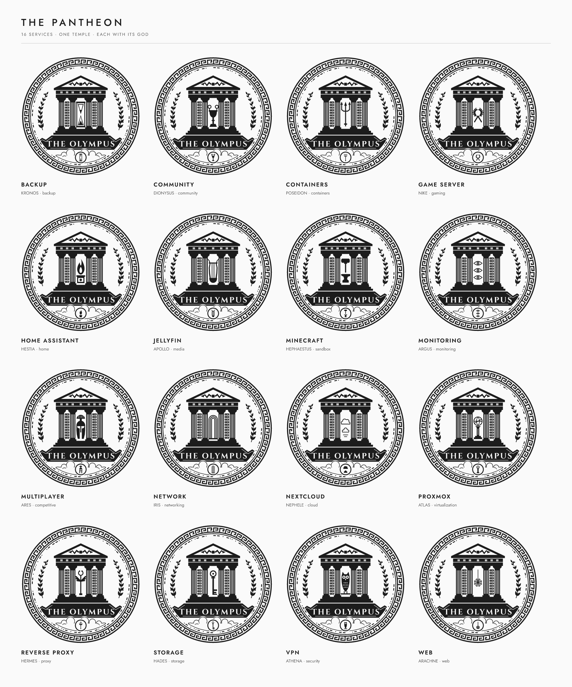
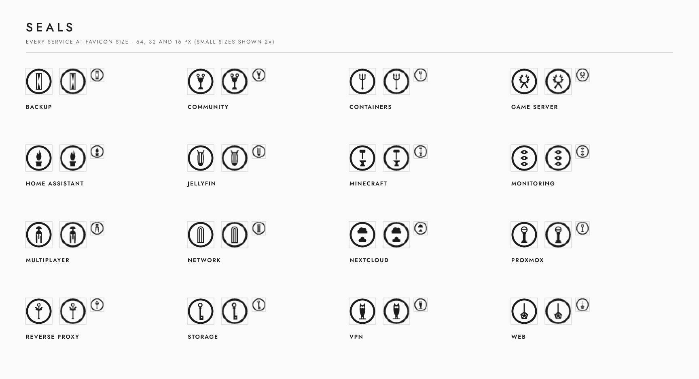

# 03 — Service catalogue

Every service in the homelab gets its own crest. The temple, the border, the
plinth and the name never change; only the **patron** in the cella (and in the
seal) changes, together with a companion lockup that carries the service name.

## The pantheon

Each category of service has a patron god, drawn as an attribute that fits the
temple's central bay:

<!-- pantheon:begin (generated by `npm run service -- build`) -->

| Category | Patron | Attribute | Domain |
|---|---|---|---|
| virtualization | Atlas | Celestial sphere on a pillar | Hypervisors, virtual machines, clusters |
| networking | Iris | Rainbow arches | Routing, DNS, DHCP, switching, connectivity |
| proxy | Hermes | Kerykeion — the herald’s winged staff | Reverse proxies, gateways, application routing |
| storage | Hades | Key | NAS, volumes, object stores, file servers |
| backup | Kronos | Hourglass | Backups, snapshots, replication, archives |
| monitoring | Argus | Watching eyes | Metrics, logs, alerting, uptime |
| security | Athena | Owl | VPN, firewalls, identity, secrets, access |
| cloud | Nephele | Clouds | Private cloud, file sync, collaboration |
| media | Apollo | Lyre | Streaming, music, photos, books |
| home | Hestia | Flame on the household altar | Home automation, IoT |
| containers | Poseidon | Trident | Container runtimes, orchestration, registries |
| web | Arachne | Web | Websites, web apps, wikis, dashboards |
| gaming | Nike | Victor’s wreath | Game servers in general |
| sandbox | Hephaestus | Hammer and anvil | Crafting and building games (e.g. Minecraft) |
| competitive | Ares | Crested helmet | Competitive and dedicated multiplayer servers |
| community | Dionysus | Kantharos — the cup of the feast | Game communities, voice, chat, events |
| other | — | The service’s initial, as a monogram | Anything else — falls back to a monogram |

<!-- pantheon:end -->

Zeus and his thunderbolt belong to the master crest alone.

## Adding a service

One command creates the catalogue entry and builds every file:

```sh
npm run service -- add --name "Vaultwarden" --category security
```

Options:

| Option | Meaning |
|---|---|
| `--name` | Display name, used in the lockups (required) |
| `--category` | One of the categories above; picks the patron (required) |
| `--id` | File and folder name; defaults to the name in kebab-case |
| `--god` | Another patron than the category's, `monogram`, or `logo` (the service's own logo; needs `--logo`) |
| `--monogram` | Letter used for monograms and the printed logo slot |
| `--logo` | An SVG app logo for the fine edition's logo slot |
| `--caption` | The lockup's second line, instead of "The Olympus · *God*" |
| `--url` | Where the service lives (`https://…`): QR labels and nameplates point here |
| `--description` | One line for the preview board |
| `--no-build` | Only write the catalogue entry |

Other commands:

```sh
npm run service -- list          # every service and its patron
npm run service -- gods          # the pantheon and who uses each god
npm run service -- categories    # categories and their default god
npm run service -- check         # validate and print-check, write nothing
npm run service -- build [id …]  # rebuild one, several or all services
npm run service -- remove <id>
```

A service is a small JSON file in `catalog/services/<id>.json`, which can also
be written by hand:

```json
{
  "id": "jellyfin",
  "name": "Jellyfin",
  "category": "media",
  "description": "Personal media streaming"
}
```

`god`, `monogram` and `logo` are optional. Logos live in `catalog/logos/`
(`--logo` copies the file there). Every filled shape becomes one ink and
white fills become cut-outs; strokes, text, images and opacity are reported
as warnings, because they cannot be engraved — convert them to filled
outlines first. In the slot, the logo appears only in the fine edition: the
print edition's slot carries the bold temple glyph, since at that size no
seal or letter keeps its shape on a 0.4 mm nozzle and the god in the cella
already identifies the service — unless the logo is the patron (below).

With `"god": "logo"` the service's own logo is its patron as well: it stands
in the temple's bay of the fine crest and the emblem, and in the seal (and
so in favicons and dashboard icons). The print editions carry it too, in the
bay and in the medallion, thickened by the least amount (up to the
monograms' own growth) that passes the same strict check as the god symbols
at 3.6 units. A logo whose details cannot hold even then keeps its own
shape, and the print check raises the smallest print diameter to suit.

## What gets built

`assets/services/<id>/`:

| File | Use |
|---|---|
| `svg/…-crest-fine*.svg` | Full crest, screen and large print |
| `svg/…-crest-print*.svg` | Filament-safe crest, single polygon path |
| `svg/…-emblem-*.svg` | Temple and name, without border |
| `svg/…-seal*.svg` | Patron seal: favicons, app icons, avatars |
| `svg/…-lockup-horizontal*.svg`, `…-lockup-vertical*.svg` | Crest with service name and caption |
| `png/` | Rasters of the above at common sizes |
| `favicon.ico` | 16, 32 and 48 px seal |
| `web/` | The web icon set for the service itself: `favicon.svg` (switches to light ink in dark mode), `favicon.ico`, `apple-touch-icon.png`, 192 / 512 px and maskable icons, `site.webmanifest`, and `head.html` with the tags to paste into a page |
| `preview.png` | Everything on one board |
| `manifest.json` | Resolved patron, print check and file checksums |

Each SVG comes in four grounds: transparent (ink), `-white`, `-on-light` and
`-on-dark`. `assets/services/index.json` lists every service.

Every build checks the parts that change per service (the patron in the
cella and the printed logo slot) against the printer's limits, strictly: a
hairline that would break or a counter that would fill fails the build. Any
letter or digit can be a monogram; all of them are tested.

## Catalogue





<!-- catalog:begin (generated by `npm run service -- build`) -->

| Seal | Service | Category | Patron | Files |
|---|---|---|---|---|
|  | **Backup** | backup | Kronos — hourglass | [files](../assets/services/backup/) |
|  | **Community** | community | Dionysus — kantharos — the cup of the feast | [files](../assets/services/community/) |
|  | **Containers** | containers | Poseidon — trident | [files](../assets/services/containers/) |
|  | **Game Server** | gaming | Nike — victor’s wreath | [files](../assets/services/game-server/) |
|  | **Home Assistant** | home | Hestia — flame on the household altar | [files](../assets/services/home-assistant/) |
|  | **Jellyfin** | media | Apollo — lyre | [files](../assets/services/jellyfin/) |
|  | **Minecraft** | sandbox | Hephaestus — hammer and anvil | [files](../assets/services/minecraft/) |
|  | **Monitoring** | monitoring | Argus — watching eyes | [files](../assets/services/monitoring/) |
|  | **Multiplayer** | competitive | Ares — crested helmet | [files](../assets/services/multiplayer/) |
|  | **Network** | networking | Iris — rainbow arches | [files](../assets/services/network/) |
|  | **Nextcloud** | cloud | Nephele — clouds | [files](../assets/services/nextcloud/) |
|  | **Proxmox** | virtualization | Atlas — celestial sphere on a pillar | [files](../assets/services/proxmox/) |
|  | **Reverse Proxy** | proxy | Hermes — kerykeion — the herald’s winged staff | [files](../assets/services/reverse-proxy/) |
|  | **Storage** | storage | Hades — key | [files](../assets/services/storage/) |
|  | **VPN** | security | Athena — owl | [files](../assets/services/vpn/) |
|  | **Web** | web | Arachne — web | [files](../assets/services/web/) |

<!-- catalog:end -->
