# The map as a city — refinement

## Audit (before)

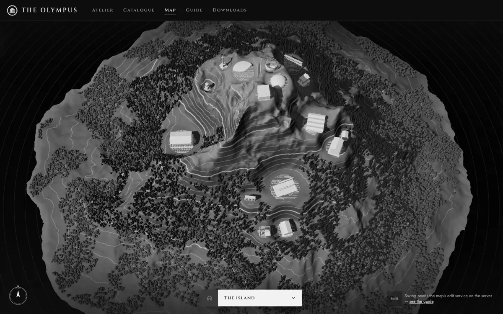
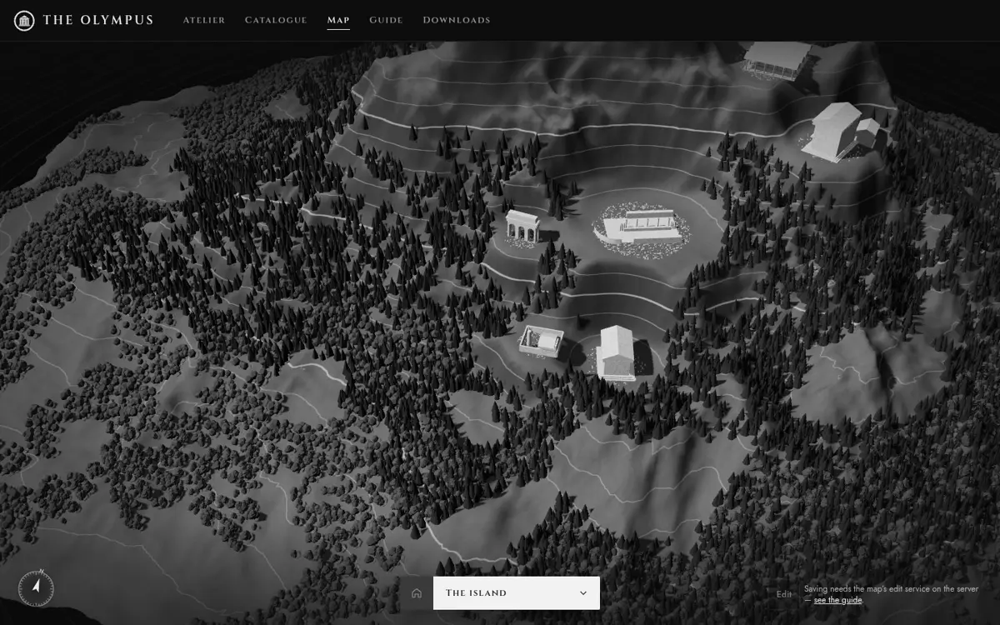
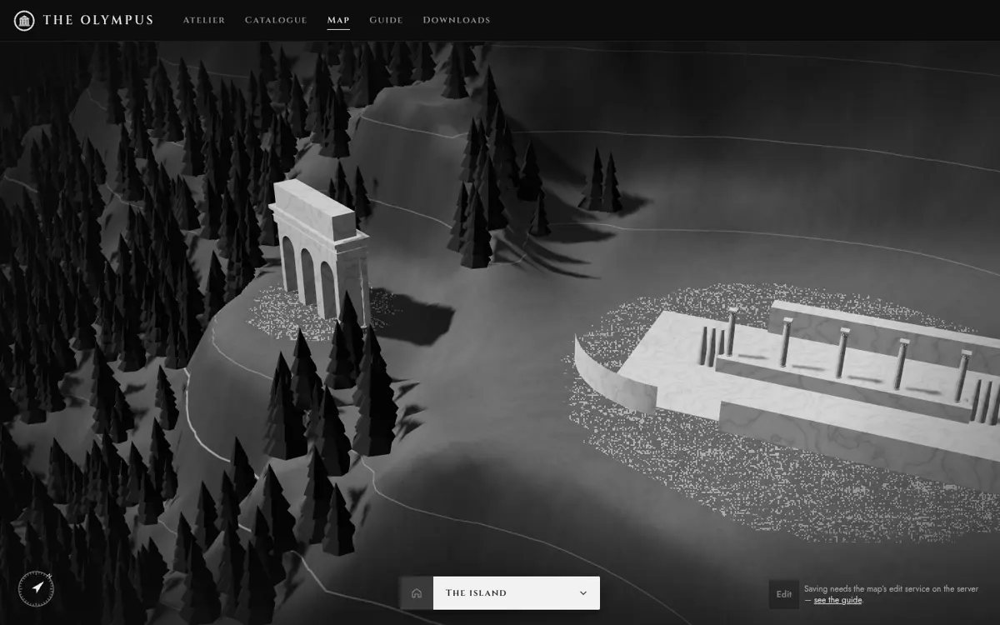
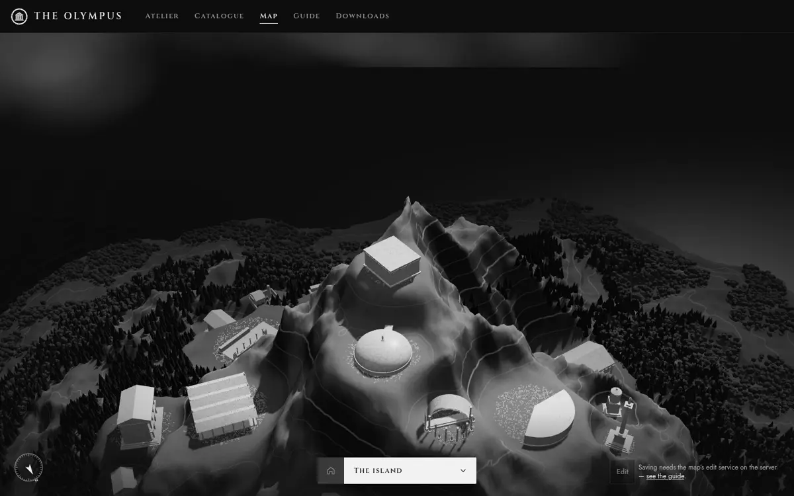

How the map is made today:

| Part | Where | What it does |
| --- | --- | --- |
| Engine | three r186, `app/src/site/map/map-scene.ts` (own chunk) | Renders on demand; MapControls; one sun with a shadow map cast once |
| Land | `src/map/terrain.ts` | Seeded noise island, 500 units across, a 625² height grid shipped as `assets/map/terrain.bin`; levelled in the browser under each building (`withTerraces`) |
| Buildings | `src/map/buildings/` | 77 hand-modelled kinds (66 for services, 11 for machines), merged geometry in one marble material, near/far detail, instanced per kind |
| Placement | `src/map/placement.ts` | Free spots on a jittered 4-unit grid; services nearest the summit first, machines on lower ground; checks only spacing, sea and slope; each building turned to face the summit |
| Vegetation | `src/map/vegetation.ts` | 25 000 broadleaf trees and pines scattered by noise, kept off terraces |
| Interaction | `MapPage`, `Hotspots`, `MapNav`, `LocationPanel`, `MapEditor` | Rings, panel, directory, deep links, editing (add, move, turn, delete, undo) |
| People, streets, paths | — | None |

One unit is about 2.6 m: a mid-sized temple is 8 × 11 units, so a person
would be about 0.7 units tall.

Why it looks random rather than like a city:

1. **No structure under the buildings.** Each one sits on its own round
   terrace in the forest, at a spot found by searching a grid outwards from
   the summit. Nothing ties two buildings together: no street, no path, no
   shared ground.
2. **Turned at the summit, not at anything near.** Every building faces the
   peak, so neighbours sit at unrelated angles.
3. **The land fights a city.** The noise land is steep almost everywhere
   (most of it rises more than 0.4 per unit); terraces are cut as discs, so
   each building looks dropped onto a bump.
4. **Nothing but landmarks.** Sixteen marble monuments and no ordinary
   fabric — no houses, squares, walls or gardens — so there is no scale and
   no density.
5. **Empty.** No people, no furniture, nothing moves except the clouds.

## Direction

The island becomes a **Greek city under the summit**, planned as the
ancient planned cities were (Priene, Miletus): a grid of streets of three
ranks on terraces stepping up the hill, the **agora** at its heart, a
sanctuary on the **acropolis** at the summit reached by a processional way,
a **works quarter** for the machines, a **grove** for a park, houses filling
every plot no service uses, and people walking the streets. Grayscale, as
the whole house is; marble stays the mark of a service, so every service
stands in its own walled precinct and everything else is plaster, tile and
limestone.

Rulings made for this pass:

- **The owner still chooses where — now among plots.** The earlier decision
  was free placement. Free placement is what made the island look random,
  so a building now snaps to the plot under the pointer, turned to its
  street. Any free plot anywhere on the island can still be chosen, and
  places saved before keep their building on the nearest free plot that
  fits it.
- **Streets do not link services to machines.** The owner asked that
  nothing suggest which machine runs which service; streets are the city's,
  not wiring.
- **The land changes.** The rough island stays round the edges and on the
  mountain; under the town it is replaced by gentle slopes, graded at build
  time into level plots and streets, with retaining walls where terraces
  step.

## Outcome (after)

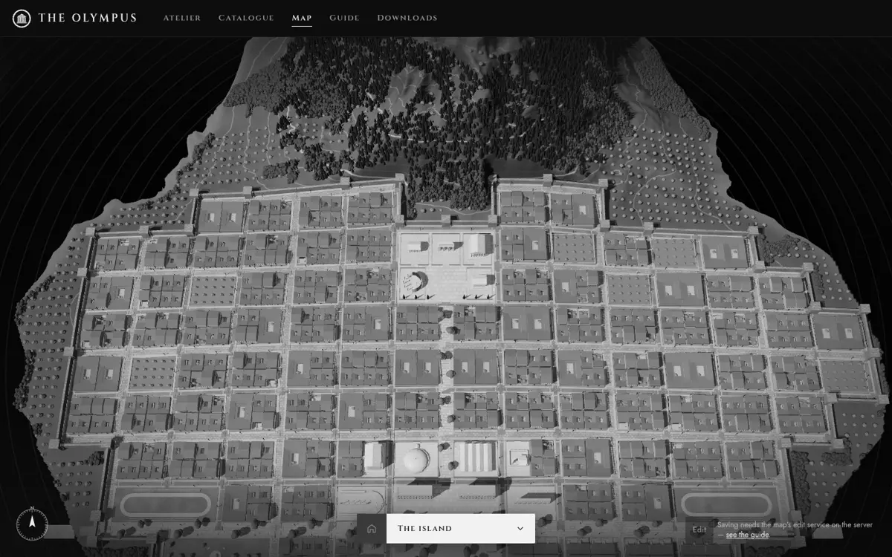
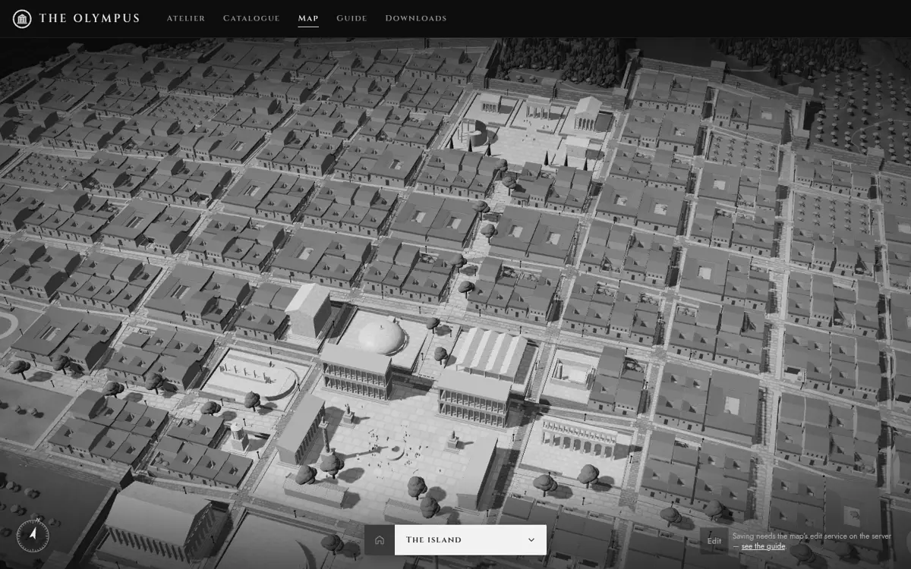
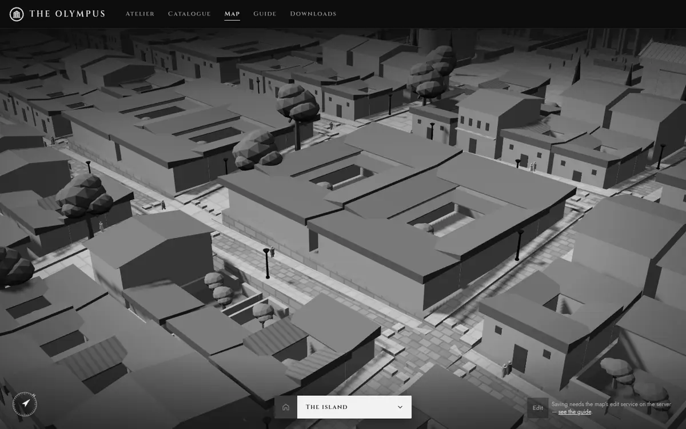
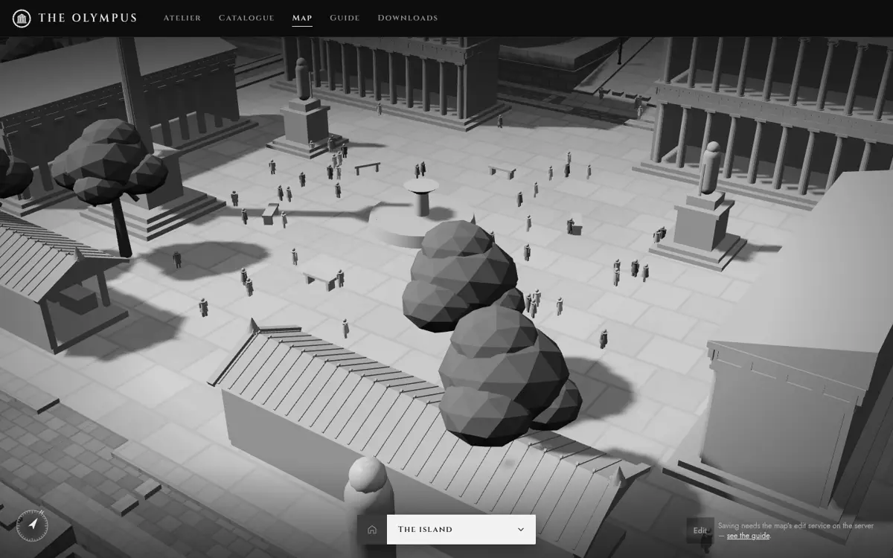
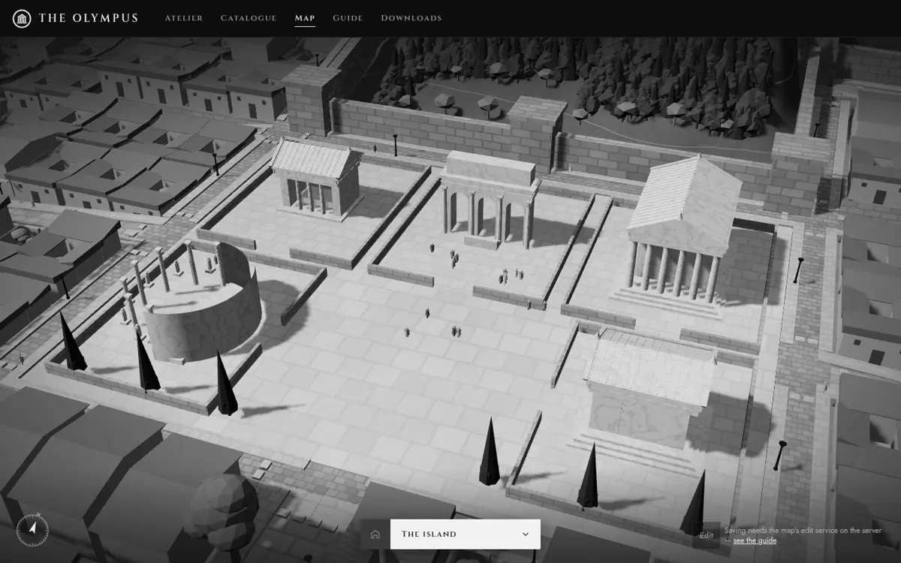
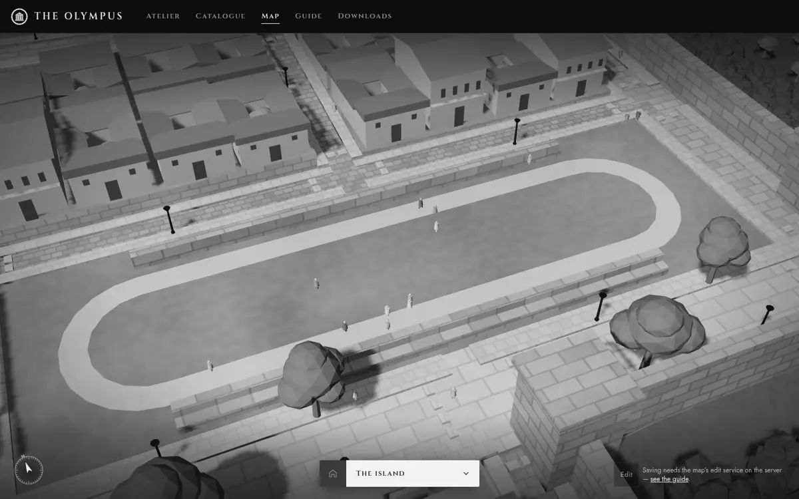
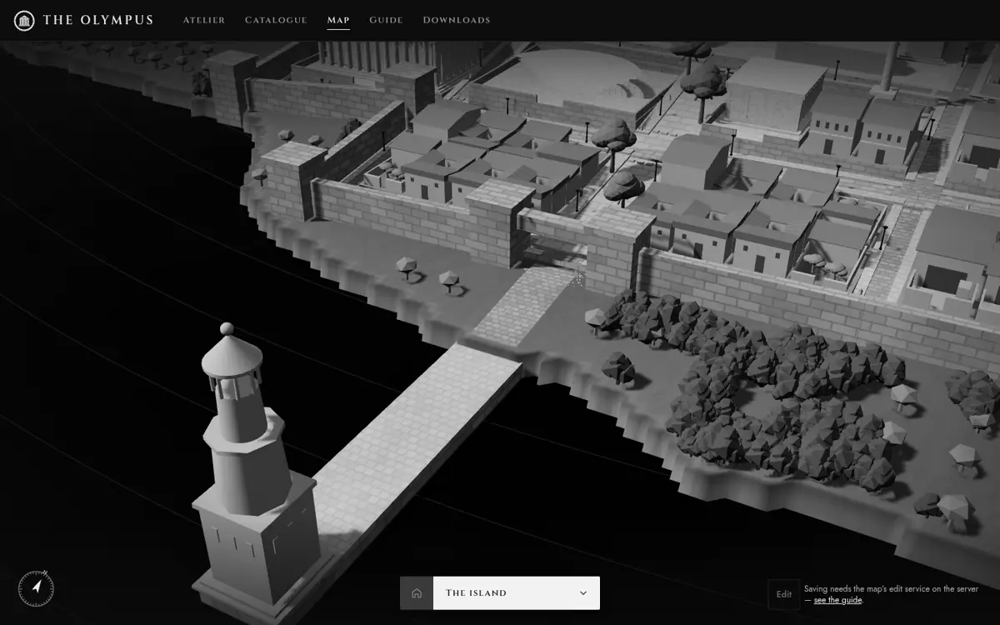
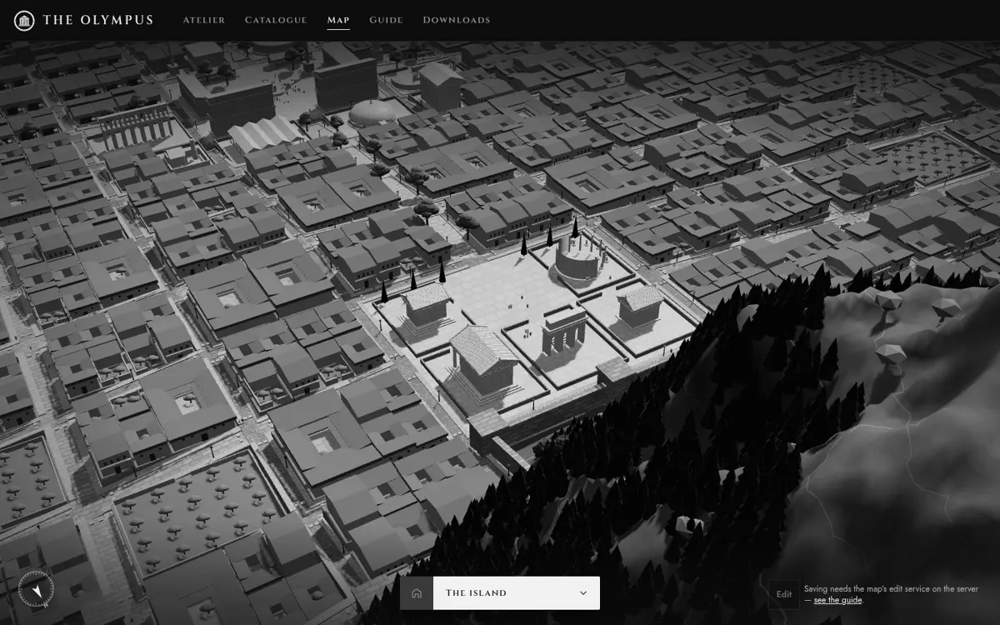
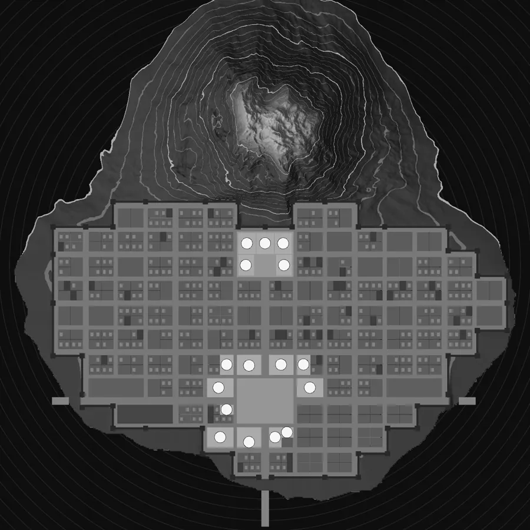

### Refinement passes

Each pass was looked at in Chrome from the same poses — overview, high,
town, quarter, street, summit, agora, lane, sanctuary, sports ground,
harbour — with `scripts/dev/map-views.ts`, and the plan from above with
`scripts/dev/city-plan.ts`.

| Pass | Seen | Done |
| --- | --- | --- |
| Plan 1–4 | A town of 27 blocks: no room for the sanctuary, room for 100 items | Wider town land, smaller blocks (22 × 18), a quay so the town reaches the sea, sports grounds |
| 3D 1 | A city at last, but the summit was flattened into a stepped ziggurat; houses as white as the marble services; one hard rectangle | The mountain moved north; the town's edge wanders; houses re-drawn (roofs to a court, gables, doorways, windows) in mid plaster and dark tile |
| 3D 2–3 | Bare striped mountain face; low contrast | Pines climb steep ground; contours fade on steep faces; darker tile |
| 3D 4 | Monotony; no boundary | Street ranks in their own stone; a city wall with towers and gates; villas, orchards, gardens and workshops among the houses |
| 3D 5 | People present but few; an empty agora; blob trees | Market stalls, statues and a column in the agora; new plane, olive and cypress trees; 420 walkers |
| 3D 6 | Every stone the same: three.js shared one compiled shader between all the stone cuts | A shader key per cut — the avenues, lanes, squares, walls and tracks became distinct |
| 3D 7 | Gates opening onto forest; sports grounds unreadable | Roads from the gates to the sea, a harbour mole with a lighthouse, landing stages; running tracks and banks |
| 3D 8 | "S" marks on the overview (two trees in each villa court); a cleared band outside the wall | One tree per court; olive groves round the town |
| 3D 9 | A cliff behind the town (blocks reaching into the mountain's foot, streets dug far below the land) | The town keeps below the mountain, its streets limited to 1 in 5, the hills come down to the wall; made ground in the town's shallows for room |
| 3D 10 | Walkers jumping sideways at corners; the agora's crowd in one ring | The side of the way eases over half a second; standing spots spread over each square |

### What the city is now

**Structure** (`src/map/city.ts`, pure, deterministic, shipped as
`assets/map/city.json`): a grid of three ranks — the sacred way and the
main street (avenues, 6 wide), streets every third or second line (4.2),
lanes between (3), each with walkways and stepping-stone crossings. 107
blocks, each a plot that can be taken whole, in halves or in quarters, all
facing their street. Squares: the agora (2 × 2 blocks where the avenues
cross), the sanctuary (2 × 2, at the head of the sacred way, five precincts
round a court), the grove (2 blocks), two sports grounds (2 blocks each,
whole or in halves). The works quarter by the harbour. A circuit wall along
every street with town on one side, towers at its corners and along it,
gates where the avenues leave; roads from the gates to the sea, the
harbour mole and lighthouse. Street grades at most 1 in 5 (the sacred way
between the agora and the sanctuary is as steep as that).

**The land** (`src/map/terrain.ts`): the summit moved north (it rises
behind the town); under the town gentle land rising from the coast, its
edge wandering; the town's shallows made ground behind its quay. Graded at
build time so the land lies just under the city's slabs.

**Placement** (`src/map/placement.ts`): a building takes the smallest free
plot that fits it (with its margin), centred, facing the street; nesting
means a half taken blocks its quarters and its whole. Temples to the
sanctuary first, machines to the works quarter, the rest nearest the agora.
150 items fit (tested). Saved places snap to the plot they stand on, or the
nearest free one.

**Fabric** (`src/map/fabric.ts`): two houses to each free quarter — mostly
courtyard houses, some two-storey, gardens, a few workshops — a peristyle
house on some free halves, an orchard on the odd free block, workshops in
the works quarter; chosen from the plot's id, so the same every time.

**People** (`app/src/site/map/people.ts`): 420 walkers (160 on a phone) on
the walking network — both walkways of every street, corners, crossings,
paths over the squares. Each has a destination (the agora most often, the
sanctuary, the grove, or a street), prefers ways that bring it closer and
does not turn back; stops 4–18 s at a square, at a spot spread over it;
some walk in pairs; keeps to its side of the way, easing round corners;
faces where it goes; four-pose stride. Position is computed from an edge
and a distance, so a frame costs a matrix per walker (0.2–0.5 ms for 420
measured in the browser); choices are made only at corners.

**Art direction**: grey only. Marble for services (the brightest thing in
the city, in a paved precinct with a low wall); plaster and dark tile for
houses; stone cut per use, from world position — pale great slabs for the
avenues and squares, flagstones for streets, dark setts for lanes, small
tiles for walkways, ashlar for terrace walls, great dark blocks for the
city wall, sand for the tracks; limestone for the city's own buildings;
lamp posts in dark bronze; plane trees on the avenues, cypresses in the
sanctuary, olives in the grove and round the town.

**Kept**: the intro, rings, panel, directory, deep links, compass, editing
(add, move, turn, change, delete, undo), the still picture (now with the
city), phones, reduced motion.

### Performance (measured)

| | Before | After |
| --- | --- | --- |
| Map chunk (gzip) | 11.3 kB | 20.9 kB |
| First-load chunk (gzip) | 75.5 kB | 75.5 kB |
| City data | — | 152 kB (21 kB gzip) |
| Triangles drawn, overview | 1.18 M | 1.50 M |
| Triangles drawn, other views | up to 1.71 M | 1.0–1.3 M close; 2.0–3.1 M looking over the forests |
| Draw calls | 46–61 | 30–88 |
| People step (420) | — | 0.2–0.5 ms |

Shadows are still cast once (people cast none); the people animate only
while the view is close enough to see them and for three minutes after the
last touch; phones get fewer people and the light scene. Frame rates were
measured only in Chrome's software renderer (1–3 fps there for the whole
scene, before and after) — not on a graphics card.

### Checked

- `npm test`: 192 (new: `tests/map-city.test.ts`, `tests/map-people.test.ts`;
  placement, terrain and data tests rewritten for plots). They check: the
  same city every time and the one shipped; one connected street network
  with no dead ends; plots beside their streets, clear of streets, squares
  and each other; land never above the city; grades at most 1 in 5; the
  walking network connected, on walkways and squares only, never across a
  plot; furniture off the plots and out of the roadways; 150 items placed,
  each inside its plot, none sharing; the crowd deterministic, on the ways,
  at a walking pace, stopping at squares, still under reduced motion.
- `npm run typecheck`, `npm run site`, `npm run app:check` (29, including
  placing a building on a plot in the browser and checking the saved place
  is a plot's), `npm run app:viewports` (6 pages × 4 sizes, axe clean).
- The journey at 1440 × 900 and 390 × 844 (intro, overview, a place, next,
  back, the directory; axe clean; no console errors).

### Limits

- Frame rates on real graphics hardware are unmeasured here.
- Houses are a handful of shapes scaled to their plots; up close they are
  simple. People are small figures with a four-pose stride, not rigged
  models.
- Pedestrians do not avoid each other; their lanes and paces keep them
  apart. They stand about the squares' furniture rather than sit.
- The city fills most of the island; it holds about 150 buildings — beyond
  that the map reports what it could not place.
- The wall and its towers are plain masonry; the gates have lintels but no
  doors.
