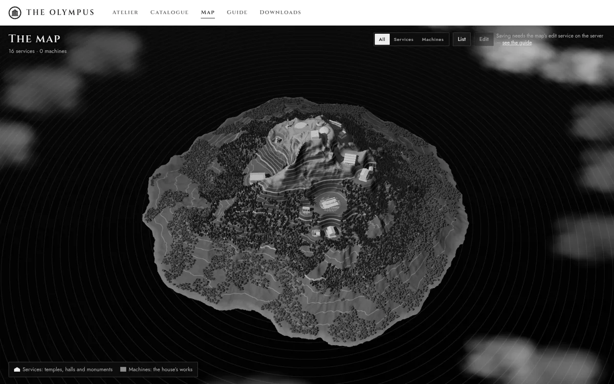
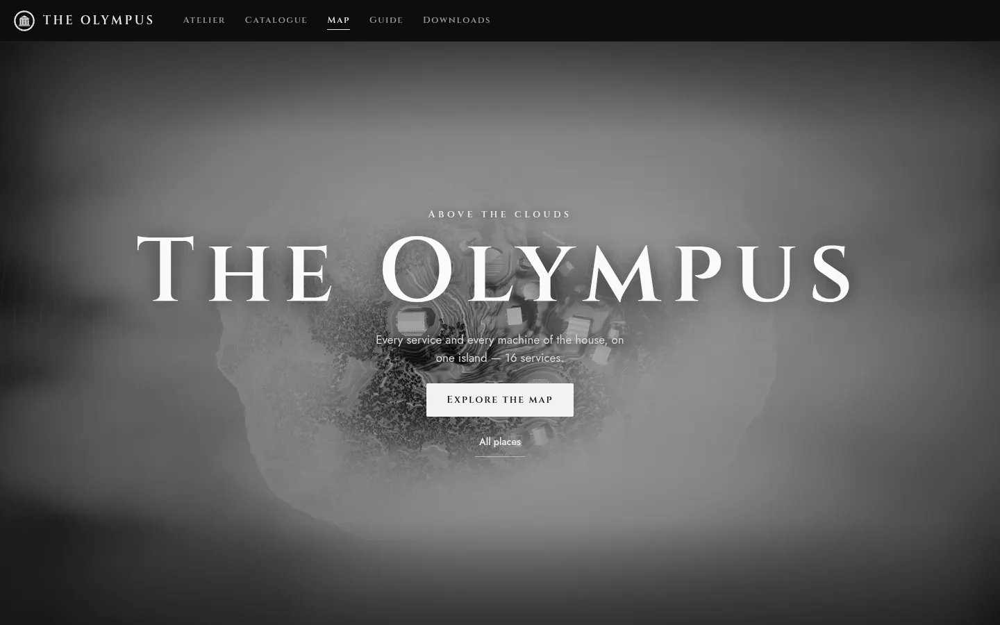
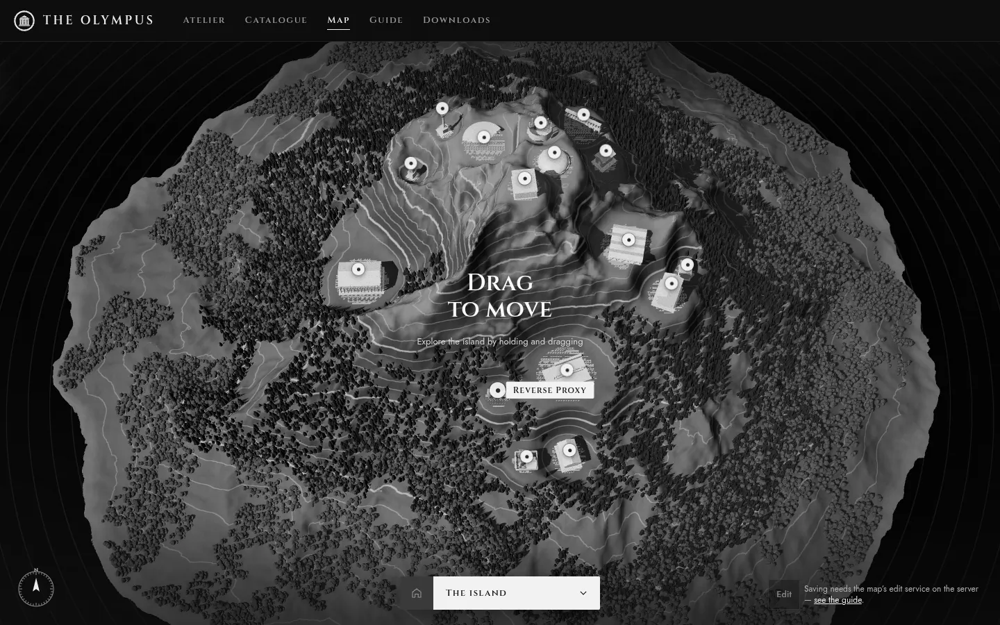
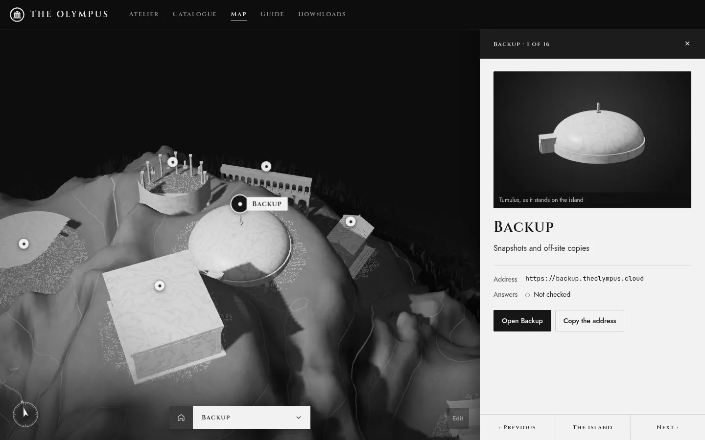
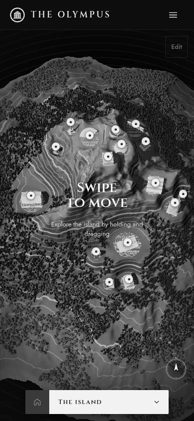
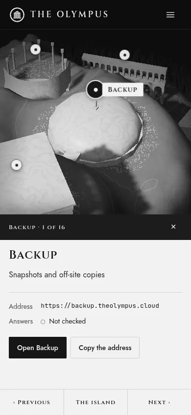
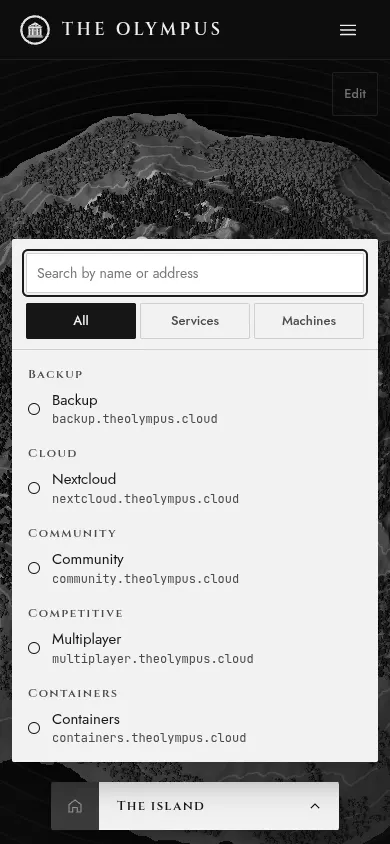
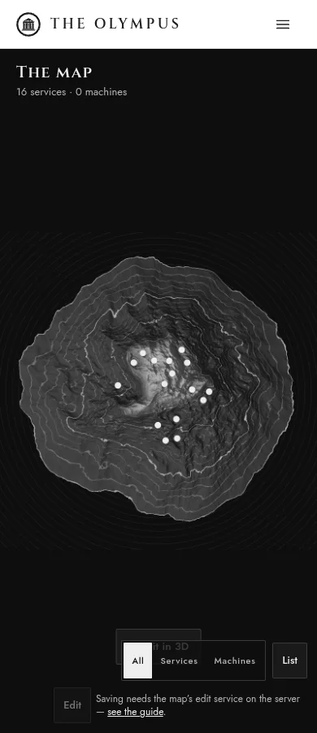

# The map — redesign

Date: 2026-10-21. The map page (`#/map`) is rebuilt as the house's central,
immersive interface, after the discovery experience of Primland's estate map
(explore.ownprimland.com, studied in a browser: desktop 1440 × 900 and phone
390 × 844). This document is the audit that started the work, the plan, and —
at the end — what was done and checked.

## What the reference does (observed)

- **Introduction.** A straight-down aerial view of the estate under drifting
  clouds; a small line above, an oversized title, one sentence, one button
  (*Explore the map*); the brand at the top centre. Nothing must be watched
  before exploring.
- **Entering.** The clouds clear; the view settles on the estate from above,
  slightly tilted. Two short lessons appear one after the other, in the centre:
  *Drag to move*, then *Scroll to zoom* (*Swipe to move* on a phone), each
  gone as soon as it has been done.
- **Overview.** Small white rings with a dot mark the places; they sit on the
  land and stay quiet. Hovering one shows its name on a light chip beside it.
  A compass sits bottom left; a bar at the bottom centre holds *home* and a
  selector (*Explore Primland ▾*) that opens upward on a short list of the key
  places; a season switch sits bottom right.
- **A place chosen.** The camera glides to it, comes down and tilts; the
  chosen ring grows and darkens; a panel slides in from the right — a title
  bar with the name and a close button, a photograph, the name again in a
  serif, a paragraph. The map stays live beside it.
- **Key areas** open a scene of their own (pool, stables, residences), with
  galleries and plans for each residence (from the design case study; not
  reachable in a scripted browser).
- **Atmosphere.** Fog, clouds drifting at the edges and over the land, soft
  shading, one warm light; the land fills the screen to its edges.
- **Phone.** The same 3D estate, full screen, swipe to move.

## The map before the redesign



What works and is kept: the island (seeded terrain, engraved contours, sea,
forests in two kinds, clouds), 77 kinds of marble building, placement and
pinning, the card's content, the online check, the edit mode and its edit
service, the still picture for phones, the data model and the rebuild.

What falls short of the reference:

| | Before | Gap |
|---|---|---|
| Arrival | the map appears at once with a small title in the corner | no introduction, nothing says what the place is |
| View | a three-quarter view from the side; the island floats in a black void | not an aerial survey; the land does not fill the screen; little depth or atmosphere |
| Places | buildings must be found and clicked in the 3D scene; hovering shows a floating name | no visible hotspots; small buildings are hard to find or hit; nothing for the keyboard on the map itself |
| Choosing | the camera eases a little closer; a card opens | no sense of travelling to a place, no close-up, no picture, no way to the next place |
| Navigation | a toolbar of buttons top right (filter, List, Edit) and a key bottom left | controls compete with the map; the list is a separate panel; no "you are here" |
| State | selection lives in React state only | no address for a place, the browser's back button does not return to the island |
| Phones | a flat picture instead of the map | the essence of the experience is missing on a phone |
| Motion | clouds drift; nothing else | no intro, no travel, no gestures taught |

## The new structure

One page, five states, each drawn by the same scene:

```
intro ──Explore──▶ overview ──choose a place──▶ travelling ──▶ place
  ▲                  ▲  │                                       │
  │                  │  └──directory / next / previous──────────┤
  └─(first visit)    └──────────── back to the island ◀─────────┘
loading (before the island is ready) · still (no WebGL, or saving data)
```

- **Intro** — the island from straight above under a cloud layer, a line
  (*Above the clouds*), the title (*The Olympus*), one sentence, **Explore the
  map**, and **All places** for the directory. Shown on the first visit in a
  session; skipped by a link to a place or under reduced motion's preference
  for less (it is then a still frame, with the same buttons).
- **Overview** — the island seen from high above, tilted a little, filling
  the screen; a marble ring over every building (a square ring for machines),
  its online mark beside it; names on hover and focus; the lessons *Drag to
  move* and *Scroll to come closer* once.
- **Travelling** — the camera glides along a smooth path to the place and
  comes down to an oblique close view framed on the building.
- **Place** — the panel (right on a desktop, a sheet from the bottom on a
  phone): the building rendered on its own, the name, what it is, the address
  with **Open**, the network details, online or offline, the building's kind,
  **Previous** and **Next** place, **Back to the island**. The camera turns
  very slowly round the building while nothing else happens (not under
  reduced motion). Editing stays where it was: the card's actions in the
  panel, **Add** in the bar.
- **Directory** — the bar's selector opens upward: every place by kind and
  category, searchable; choosing one travels there. It is the way to every
  place without the map, and the keyboard's.

The address follows the state: `#/map` is the island, `#/map/<id>` a place;
the browser's back button returns to the island, and a link opens a place
directly. The selected place is one value that the camera, the rings, the
directory and the panel all read.

The house stays the house: grayscale only, Cinzel for names and titles, Jost
for the rest, marble for what is light (the panel and the bar take the place
of the reference's cream), graphite stone for the land.

## Plan

1. Scene: aerial camera with framing for the overview and for each place,
   travel along an eased path, a slow turn at a place; clouds as a layer that
   parts at the start; their shadows drifting on the land; fog and a vignette
   for depth; a light version for phones (pixel ratio 1, smaller shadow map,
   fewer clouds).
2. Hotspots: a layer of buttons placed over the buildings from the scene's
   projection, updated only when the view changes.
3. Page: intro, bar with home, selector and directory, compass, place panel
   with the building's portrait, lessons, states synchronised with the address.
4. Phones: the 3D map with touch (swipe, pinch), the panel as a bottom sheet;
   the picture only without WebGL or when saving data.
5. Checks: the browser checks drive intro → overview → place → next → back →
   directory on desktop and phone; viewports at 360, 390, 768, 1024 and 1440.

## Outcome





On a phone: 



Before: 


### What changed

| Part | Files |
| --- | --- |
| Scene: overview and place framing, eased travel with a lift, slow turn at a place, clouds that part, cloud shadows on the land, distance fog, phone version | `app/src/site/map/map-scene.ts`, `land.ts` |
| Rings over the buildings (buttons, named, keyboard) | `Hotspots.tsx` |
| Place panel / bottom sheet, portrait of the building, previous / next | `LocationPanel.tsx`, `thumbs.ts` (`portrait`) |
| Bar, directory with search and filter, compass | `MapNav.tsx` |
| States, intro, lessons, address `#/map/<id>`, Escape | `MapPage.tsx`, `App.tsx` |
| Styles (stone header over the map, marble panels, phone and tablet layouts) | `map.css` |
| Removed: the old card and list | `MapCard.tsx`, `MapList.tsx` |

Editing is unchanged in behaviour: **Edit** sits in the map's corner (top
right below 1280 px), the building's actions sit in its panel, the form
opens beside the map.

### States

`data-phase` on `.map`: `loading` → `intro` (first visit in a session, no
link to a place) → `entering` (the clouds part) → `overview` →
`travelling` → `place`; and `still` (no WebGL, or saving data). The place is
the address, so the camera, the rings, the directory and the panel never
disagree; the back button and links work.

### Checked

- `npm test` (182), `npm run typecheck`, `npm run site`.
- `npm run app:check`: intro, a ring per service, the directory searched, a
  place with its address, next, the back button, back to the island, a ring
  opened with Enter and closed with Escape, a link to a place, names shown
  as text, pinging, the whole editing flow, a phone place sheet, reduced
  motion holding still.
- `npm run app:viewports`: no overflow, no hued colour, axe clean.
- `scripts/dev/map-journey.ts` at 1440×900, 1024×768, 768×1024, 390×844 and
  360×800: intro → overview → place → next → back → directory, each state
  photographed and audited with axe (no violations), no console errors.

### Limits

- The panel's picture is a render of the building, not a photograph.
- A place is a close-up of the same island, not a scene of its own.
- Frame rates were measured only in a software renderer (SwiftShader);
  a real GPU has not been timed here.
