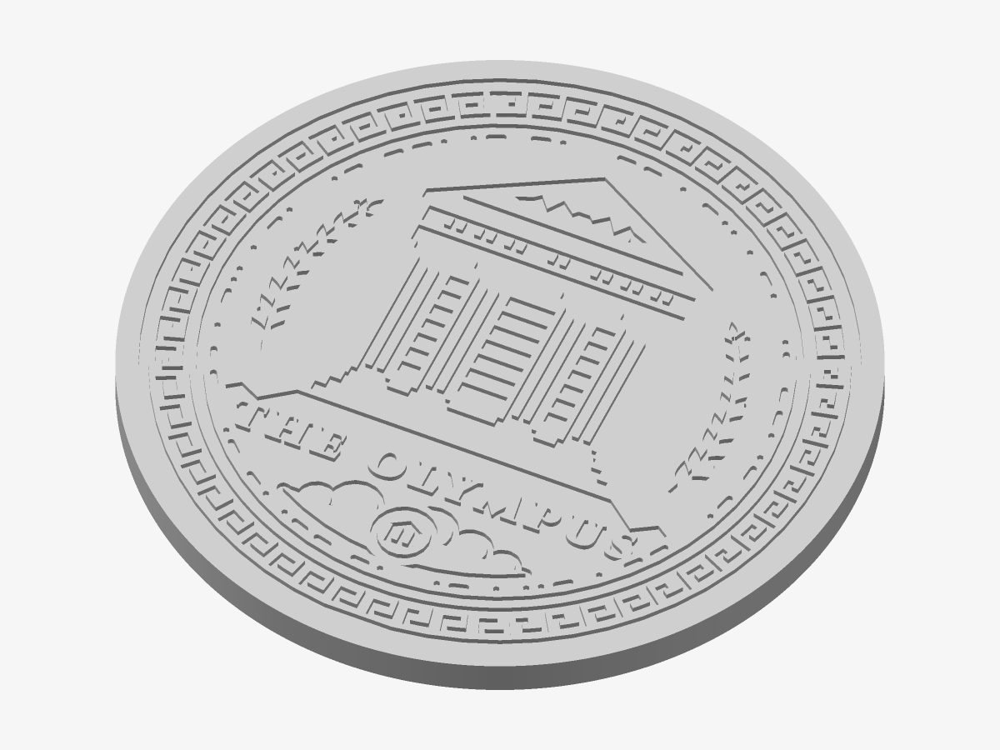
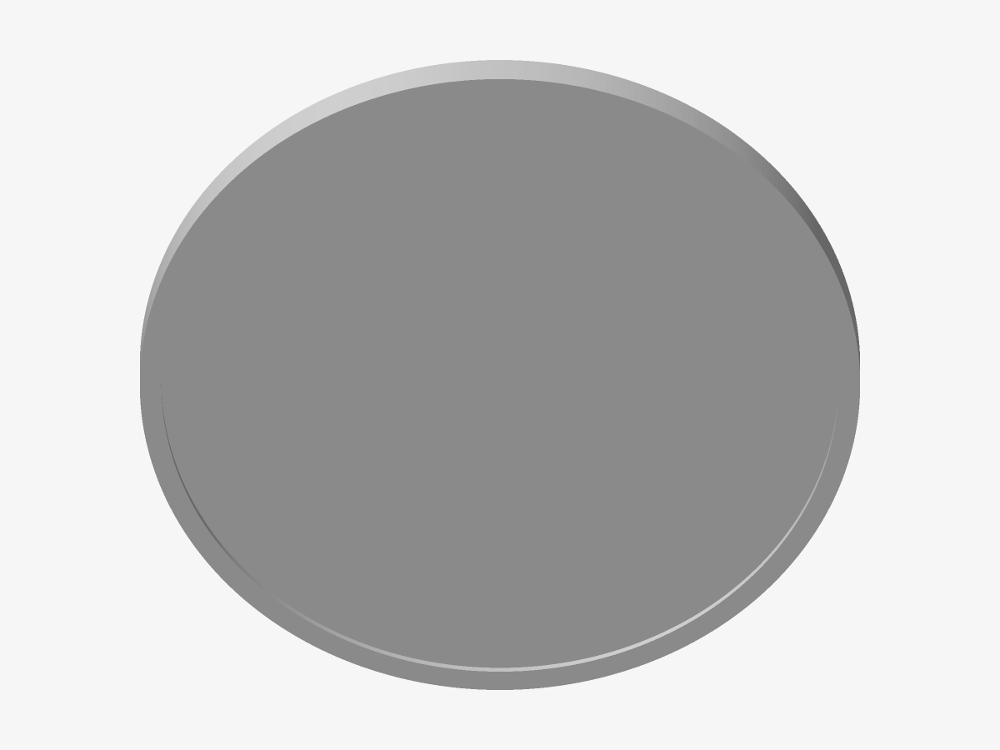

# The Olympus — Coaster

The crest engraved flush, so a glass stands level — with a recess underneath for a felt or cork pad.

*Preview rendered from the mesh itself.*

*The back: a pad recess.*

| | |
|---|---|
| Size | 100 × 100 × 5 mm |
| Volume | 29.9 cm³ |
| Filament | ≈ 15 g, 5.1 m of 1.75 mm at 15 % infill (an estimate) |
| Design prints from | Ø 67 mm on a 0.4 mm nozzle |

## Parameters

| Parameter | Value | |
|---|---|---|
| Diameter | 100 mm | Outer diameter. |
| Flange | 3 mm | Solid border around the crest. |
| Thickness | 5 mm | Total thickness. |
| Engraving depth | 0.8 mm | Shallow keeps it easy to wipe. |
| Pad recess | on | A shallow recess in the base for a felt or cork pad, so it never scratches the table. |
| Recess depth | 1 mm | The thickness of the pad. |

## Files

- `the-olympus-master-coaster.stl` — the solid, ready to slice
- `the-olympus-master-coaster.3mf` — the same solid, in 3MF
- `the-olympus-master-coaster.scad` — parametric source for OpenSCAD

## Validation

- **coaster**: valid — 24,832 triangles, closed and manifold (0 open or doubled edges), 0 degenerate triangles, no self-intersection (0 overlapping layers), volume 29.92 cm³ as designed.

## Printing

- Print flat on the bed, design facing up. No supports needed.
- Layers of 0.2 mm: the heights below are whole numbers of layers unless noted.
- Stick a Ø 94 × 1 mm felt or cork pad into the recess.
- The top is flat, so glasses stand level. PETG copes better than PLA with a hot mug; neither is for food contact.
- For contrast, wipe dark acrylic paint into the engraving and clean the top face; or print in a speckled “marble” filament.
