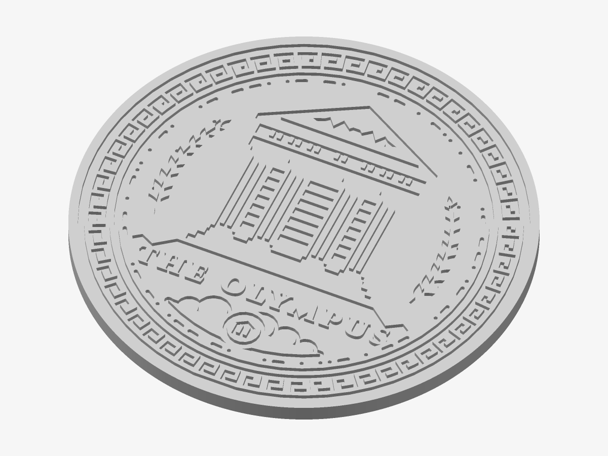
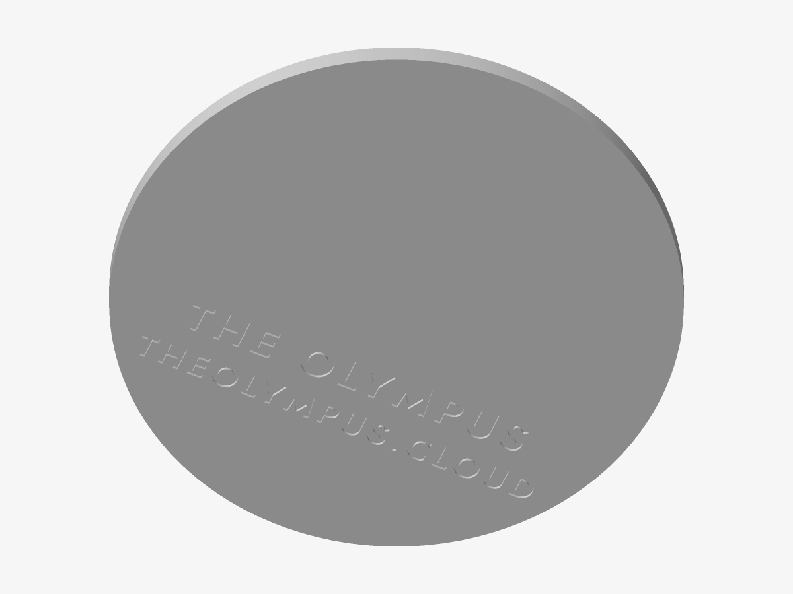

# The Olympus — Engraved medallion

The crest cut into a solid plate — quiet, stone-like, best in one light filament.

*Preview rendered from the mesh itself.*

*The back: the inscription.*

| | |
|---|---|
| Size | 100 × 100 × 4 mm |
| Volume | 28.1 cm³ |
| Filament | ≈ 15 g, 5.1 m of 1.75 mm at 15 % infill (an estimate) |
| Design prints from | Ø 67 mm on a 0.4 mm nozzle |

## Parameters

| Parameter | Value | |
|---|---|---|
| Diameter | 100 mm | Outer diameter of the plate. |
| Flange | 2 mm | Solid border left around the crest’s rim. |
| Plate thickness | 4 mm | Total thickness. |
| Engraving depth | 1 mm | How deep the design is cut. |
| Magnet pockets | 0 | Round pockets for disc magnets: hangs on a rack door, a fridge, a steel panel. Glue the magnets in after printing. |
| Magnet diameter | 10.2 mm | Pocket diameter: the magnet plus about 0.2 mm. |
| Magnet depth | 2.2 mm | Pocket depth: the magnet’s thickness plus about 0.2 mm. |
| Keyhole hanger | off | A keyhole slot to hang it on a 3.5–4 mm screw (head up to 8 mm). Needs a plate of 4.2 mm or more. |
| Back inscription | on | The name and theolympus.cloud, engraved mirrored on the back so it reads when turned over. |

## Files

- `the-olympus-master-engraved.stl` — the solid, ready to slice
- `the-olympus-master-engraved.3mf` — the same solid, in 3MF
- `the-olympus-master-engraved.scad` — parametric source for OpenSCAD

## Validation

- **engraved medallion**: valid — 30,604 triangles, closed and manifold (0 open or doubled edges), 0 degenerate triangles, no self-intersection (0 overlapping layers), volume 28.13 cm³ as designed.

## Printing

- Print flat on the bed, design facing up. No supports needed.
- Layers of 0.2 mm: the heights below are whole numbers of layers unless noted.
- The inscription on the back (The Olympus · theolympus.cloud) is cut 0.6 mm deep into the first layers; it reads when the piece is turned over.
- For contrast, wipe dark acrylic paint into the engraving and clean the top face; or print in a speckled “marble” filament.
