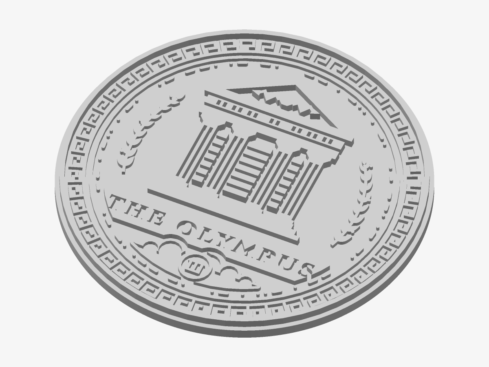
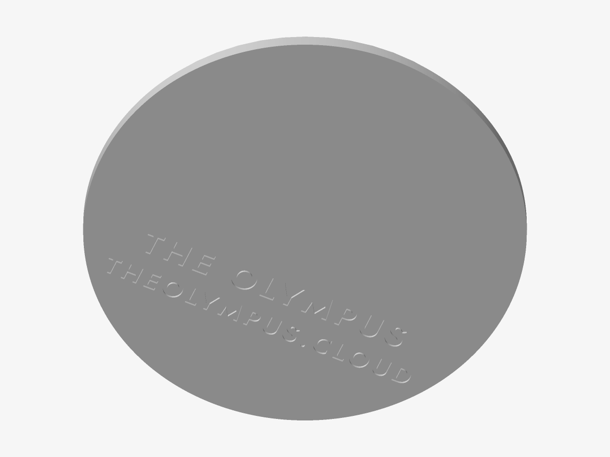

# The Olympus — Layered medallion

The crest in tiers of relief — rim, border, temple, name, laurels and clouds each at its own height, like a struck coin. One filament, or a colour per tier.

*Preview rendered from the mesh itself.*

*The back: the inscription.*

| | |
|---|---|
| Size | 100 × 100 × 5.4 mm |
| Volume | 29.3 cm³ |
| Filament | ≈ 17 g, 5.7 m of 1.75 mm at 15 % infill (an estimate) |
| Design prints from | Ø 67 mm on a 0.4 mm nozzle |

## Parameters

| Parameter | Value | |
|---|---|---|
| Diameter | 100 mm | Outer diameter of the plate. |
| Flange | 1.2 mm | Plate left around the crest’s rim. |
| Plate thickness | 3 mm | A multiple of your layer height keeps the tiers crisp. |
| Depth | Coin | How the heights are shared out between the parts of the crest. |
| Deepest relief | 2.4 mm | The highest tier. The others are shares of it, rounded to whole layers. |
| Parts | One part | One solid, or the plate and each tier as parts of their own. |
| Magnet pockets | 0 | Round pockets for disc magnets: hangs on a rack door, a fridge, a steel panel. Glue the magnets in after printing. |
| Magnet diameter | 10.2 mm | Pocket diameter: the magnet plus about 0.2 mm. |
| Magnet depth | 2.2 mm | Pocket depth: the magnet’s thickness plus about 0.2 mm. |
| Keyhole hanger | off | A keyhole slot to hang it on a 3.5–4 mm screw (head up to 8 mm). Needs a plate of 4.2 mm or more. |
| Back inscription | on | The name and theolympus.cloud, engraved mirrored on the back so it reads when turned over. |

## Files

- `the-olympus-master-layered.stl` — the solid, ready to slice
- `the-olympus-master-layered.3mf` — the same solid, in 3MF
- `the-olympus-master-layered.scad` — parametric source for OpenSCAD

## Validation

- **medallion**: valid — 34,228 triangles, closed and manifold (0 open or doubled edges), 0 degenerate triangles, no self-intersection (0 overlapping layers), volume 29.33 cm³ as designed.

## Printing

- Print flat on the bed, design facing up. No supports needed.
- Layers of 0.2 mm: the heights below are whole numbers of layers unless noted.
- The inscription on the back (The Olympus · theolympus.cloud) is cut 0.6 mm deep into the first layers; it reads when the piece is turned over.
- Tiers: 1.20 mm — border ornament, laurels, clouds; 1.80 mm — name plinth; 2.40 mm — rim, temple.
- Thickest point 5.4 mm — the desk stand’s slot should match.
