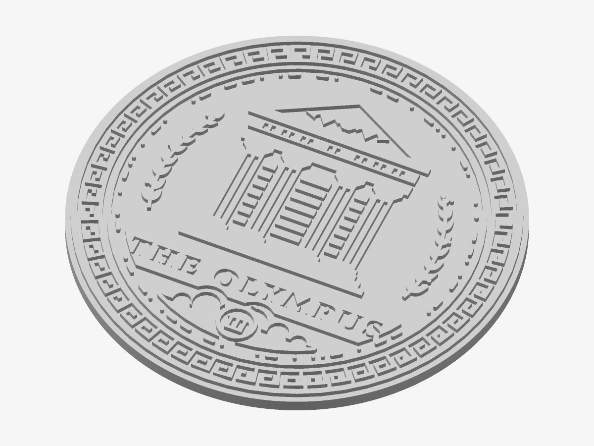

# The Olympus — Medallion

The crest raised on a round backing plate — a wall or desk piece, a rack badge with magnets.

*Preview rendered from the mesh itself.*

| | |
|---|---|
| Size | 100 × 100 × 4.2 mm |
| Volume | 27.5 cm³ — at most 35 g of PLA solid; much less at 15–20 % infill |
| Mark prints from | Ø 67 mm on a 0.4 mm nozzle |

## Parameters

| Parameter | Value | |
|---|---|---|
| Diameter | 100 mm | Outer diameter of the plate. |
| Flange | 1.2 mm | Plate left around the crest’s rim. |
| Plate thickness | 3 mm | A multiple of your layer height keeps the relief crisp. |
| Relief height | 1.2 mm | How far the design stands proud of the plate. |
| Magnet pockets | 0 | Round pockets in the back for disc magnets: hangs on a rack door, a fridge, a steel panel. Glue the magnets in after printing. |
| Magnet diameter | 10.2 mm | Pocket diameter: the magnet plus about 0.2 mm. |
| Magnet depth | 2.2 mm | Pocket depth: the magnet’s thickness plus about 0.2 mm. |

## Files

- `the-olympus-master-medallion.stl` — the solid, ready to slice
- `the-olympus-master-medallion.3mf` — the same solid, in 3MF
- `the-olympus-master-medallion.scad` — parametric source for OpenSCAD, reading `the-olympus-master-crest-print.svg`

## Validation

- **medallion**: valid — 21,832 triangles, closed and manifold (0 open or doubled edges), 0 degenerate triangles, no self-intersection (0 overlapping layers), volume 27.46 cm³ as designed.

## Printing

- Print flat on the bed, design facing up. No supports needed.
- Layer height 0.2 mm or finer; heights that are multiples of it come out exact.
- Thickest point 4.2 mm — the desk stand’s slot should match.
