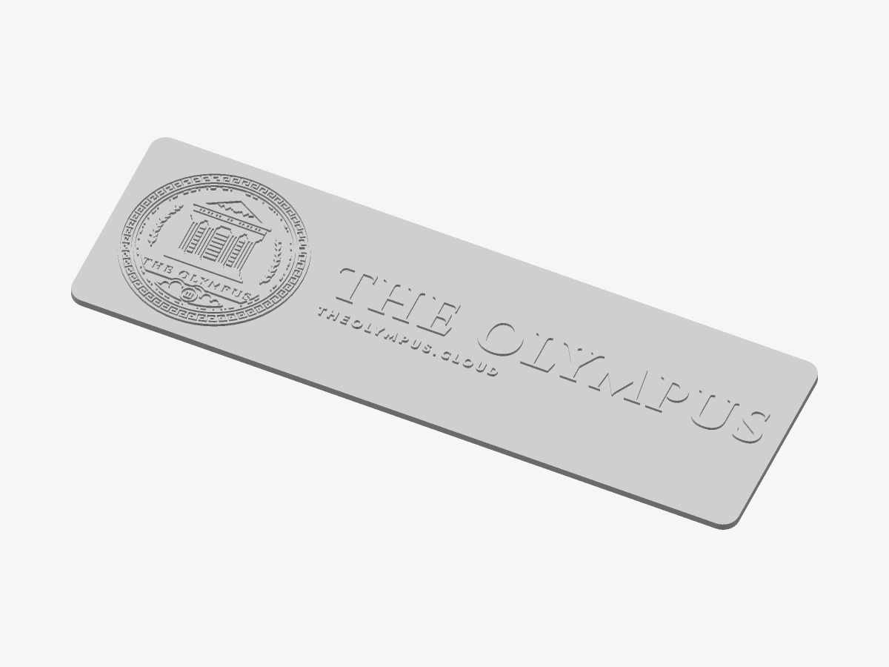
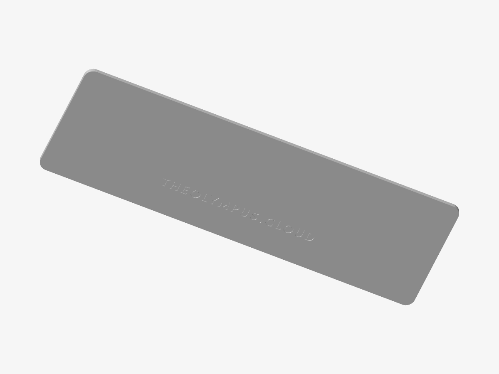

# The Olympus — Nameplate

The crest with the service’s name and caption on a plate — for a server, a rack, a door.

*Preview rendered from the mesh itself.*

*The back: the inscription.*

| | |
|---|---|
| Size | 256 × 79.1 × 4.2 mm |
| Volume | 63.5 cm³ |
| Filament | ≈ 33 g, 11.2 m of 1.75 mm at 15 % infill (an estimate) |
| Design prints from | Ø 67 mm on a 0.4 mm nozzle |

## Parameters

| Parameter | Value | |
|---|---|---|
| Height | 80 mm | Height of the plate; the length follows the name. |
| Layout | Horizontal | The name beside the crest, or beneath it. |
| Caption | on | The line under the name (“The Olympus · …”). |
| Margin | 5 mm | Plate left around the design. |
| Corner radius | 6 mm | Rounding of the plate’s corners. |
| Plate thickness | 3 mm | A multiple of your layer height keeps the relief crisp. |
| Relief height | 1.2 mm | How far the design stands proud of the plate. |
| Bed size | 256 mm | The longest side your printer takes; a longer plate is scaled down to fit. |
| Magnet pockets | 0 | Round pockets for disc magnets: hangs on a rack door, a fridge, a steel panel. Glue the magnets in after printing. |
| Magnet diameter | 10.2 mm | Pocket diameter: the magnet plus about 0.2 mm. |
| Magnet depth | 2.2 mm | Pocket depth: the magnet’s thickness plus about 0.2 mm. |
| Keyhole hanger | off | A keyhole slot to hang it on a 3.5–4 mm screw (head up to 8 mm). Needs a plate of 4.2 mm or more. |
| Back inscription | on | The name and theolympus.cloud, engraved mirrored on the back so it reads when turned over. |

## Files

- `the-olympus-master-nameplate.stl` — the solid, ready to slice
- `the-olympus-master-nameplate.3mf` — the same solid, in 3MF
- `the-olympus-master-nameplate.scad` — parametric source for OpenSCAD

## Validation

- **nameplate**: valid — 34,168 triangles, closed and manifold (0 open or doubled edges), 0 degenerate triangles, no self-intersection (0 overlapping layers), volume 63.47 cm³ as designed.

## Printing

- Print flat on the bed, design facing up. No supports needed.
- Layers of 0.2 mm: the heights below are whole numbers of layers unless noted.
- The inscription on the back (theolympus.cloud) is cut 0.6 mm deep into the first layers; it reads when the piece is turned over.

## Warnings

- Scaled down to fit a 256 mm bed (256 × 79.1 mm). A vertical layout keeps long names larger.
