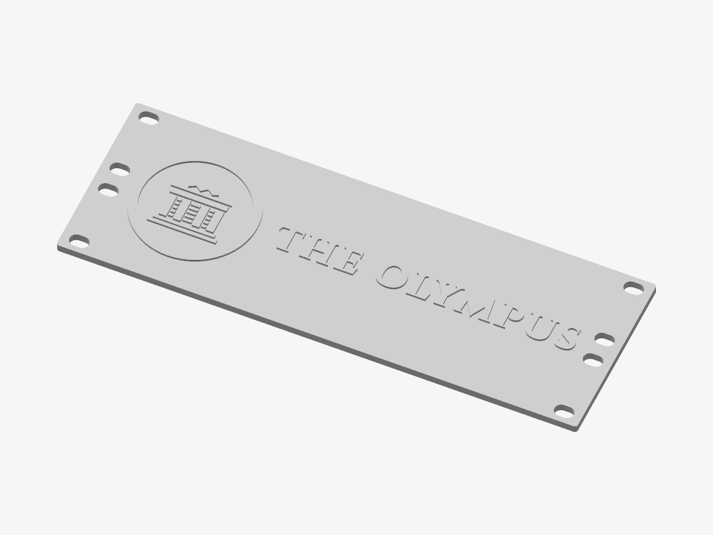

# The Olympus — Rack panel

A front panel for a 10-inch rack — the seal and the service’s name raised between the mounting slots, with vents either side.

*Preview rendered from the mesh itself.*

| | |
|---|---|
| Size | 254 × 88.1 × 5.2 mm |
| Volume | 90.2 cm³ |
| Filament | ≈ 39 g, 13.0 m of 1.75 mm at 15 % infill (an estimate) |
| Design prints from | Ø 56 mm on a 0.4 mm nozzle |

## Parameters

| Parameter | Value | |
|---|---|---|
| Height | 2 U | Rack units: 1U is 44.45 mm (the panel is 0.79 mm less, to clear its neighbours). |
| Hole spacing | 236.5 mm | Between the mounting holes’ centres. Most 10-inch racks: 236.5 mm — measure yours. |
| Slot width | 6.5 mm | Mounting slots: 6.5 mm for M6 screws and cage nuts, 5.5 mm for M5. |
| Vents | on | Slots through the panel either side of the design, for air. |
| Caption | off | The line under the name. At 1U it is small: it may print too fine. |
| QR code | off | The service’s address as a QR code beside the name. Print the relief in a contrasting colour so phones can read it. |
| Corner radius | 1.5 mm | Rounding of the panel’s corners. |
| Panel thickness | 4 mm | Thick enough not to flex across 254 mm. |
| Relief height | 1.2 mm | How far the design stands proud of the panel. |

## Files

- `the-olympus-master-rack.stl` — the solid, ready to slice
- `the-olympus-master-rack.3mf` — the same solid, in 3MF
- `the-olympus-master-rack.scad` — parametric source for OpenSCAD

## Validation

- **panel**: valid — 7,116 triangles, closed and manifold (0 open or doubled edges), 0 degenerate triangles, no self-intersection (0 overlapping layers), volume 90.23 cm³ as designed.

## Printing

- Print flat on the bed, design facing up. No supports needed.
- Layers of 0.2 mm: the heights below are whole numbers of layers unless noted.
- The name is long for the panel: the design was made smaller to fit between the mounting slots.
- There is no room for vents beside this design.
- The panel is 254 mm long: it fits a 256 mm bed straight, or a 220 mm bed laid on the diagonal.
- Mounting slots 6.5 × 9.5 mm, 236.5 mm apart. 10-inch racks are not all alike: check the spacing against yours before printing.
