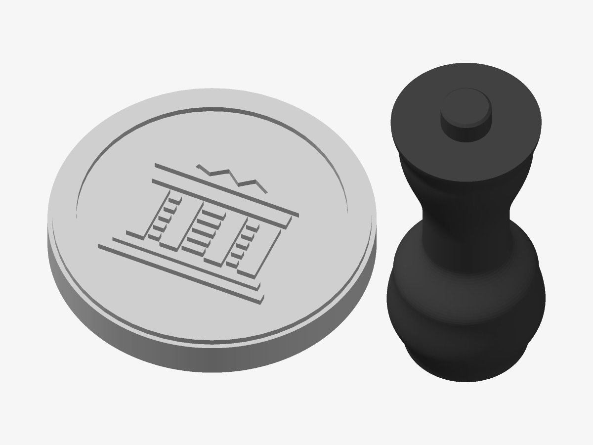

# The Olympus — Wax-seal stamp

The seal, mirrored, on a die with a turned handle — to seal letters in wax with the house’s mark.

*Preview rendered from the mesh itself.*

| | |
|---|---|
| Size | 92 × 58 × 64.6 mm |
| Volume | 42.9 cm³ |
| Filament | ≈ 14 g, 4.6 m of 1.75 mm at 15 % infill (an estimate) |
| Design prints from | Ø 56 mm on a 0.4 mm nozzle |

## Parameters

| Parameter | Value | |
|---|---|---|
| Die diameter | 58 mm | Diameter of the die; the impression is this size. |
| Flange | 0.8 mm | Die left around the seal’s ring. |
| Die thickness | 7 mm | The handle’s peg sits in a socket in it. |
| Relief depth | 1.2 mm | How deep the impression is: 1–1.5 mm suits wax. |
| Handle length | 60 mm | From the knob to the die (the peg adds to it). |
| Peg clearance | 0.25 mm | Added to the socket; the peg is glued in. |

## Files

- `the-olympus-master-stamp-die.stl` — the die
- `the-olympus-master-stamp-handle.stl` — the handle
- `the-olympus-master-stamp.3mf` — both parts as one object, each ready for its own filament
- `the-olympus-master-stamp.scad` — parametric source for OpenSCAD

## Validation

- **die**: valid — 2,354 triangles, closed and manifold (0 open or doubled edges), 0 degenerate triangles, no self-intersection (0 overlapping layers), volume 19.55 cm³ as designed.
- **handle**: valid — 24,192 triangles, closed and manifold (0 open or doubled edges), 0 degenerate triangles, no self-intersection (0 overlapping layers), volume 23.39 cm³ as designed.

## Printing

- No supports needed.
- Layers of 0.2 mm: the heights below are whole numbers of layers unless noted.
- Two parts: the die, design up, and the handle, standing on its knob (a brim helps it stay put). Glue the handle’s peg into the socket under the die.
- The design is mirrored on the die, so the impression reads the right way.
- PLA softens at about 60 °C and sealing wax is poured at 80–100 °C: chill the die (a minute on an ice pack) before each impression, press for a few seconds and lift once the wax has set. Glue-gun sealing wax runs cooler. For many impressions, print in PETG — or have the die cast in brass from this model.
