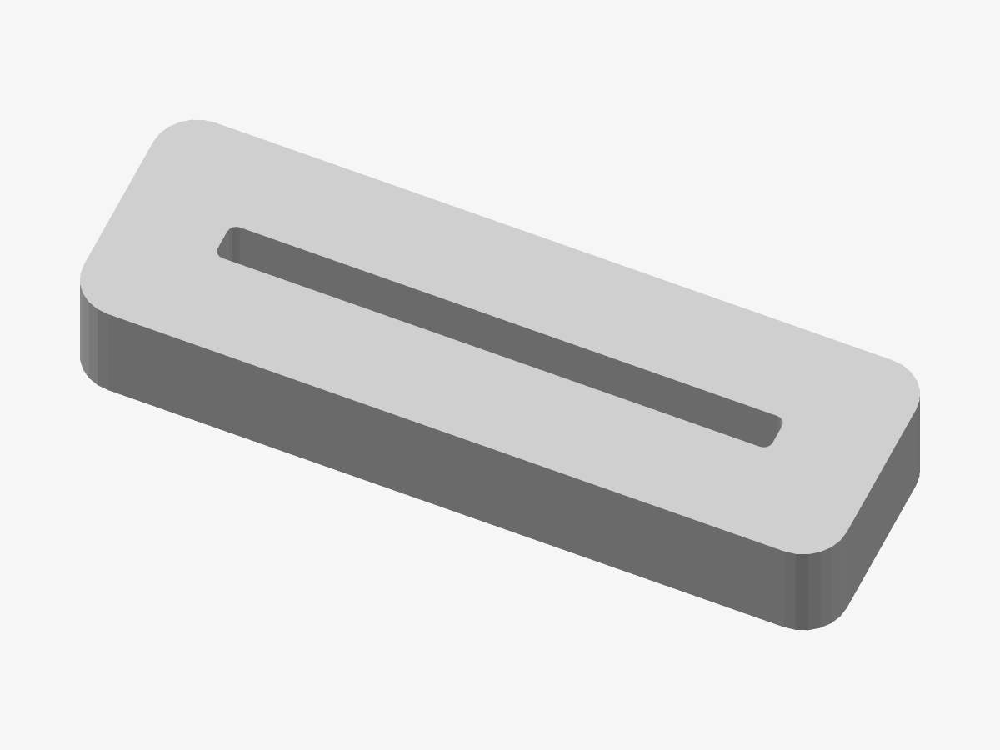

# The Olympus — Desk stand

A slotted foot that holds a medallion or lithophane upright on a desk or shelf.

*Preview rendered from the mesh itself.*

| | |
|---|---|
| Size | 88 × 28 × 13 mm |
| Volume | 28.9 cm³ |
| Filament | ≈ 9 g, 3.2 m of 1.75 mm at 15 % infill (an estimate) |

## Parameters

| Parameter | Value | |
|---|---|---|
| Medallion diameter | 100 mm | The medallion it holds. |
| Medallion thickness | 4.2 mm | Its thickest point: plate plus relief. |
| Clearance | 0.3 mm | Added to the slot width; tune it to your printer. |
| Slot depth | 10 mm | How much of the medallion sits in the foot. |

## Files

- `the-olympus-master-stand.stl` — the solid, ready to slice
- `the-olympus-master-stand.3mf` — the same solid, in 3MF
- `the-olympus-master-stand.scad` — parametric source for OpenSCAD

## Validation

- **stand**: valid — 244 triangles, closed and manifold (0 open or doubled edges), 0 degenerate triangles, no self-intersection (0 overlapping layers), volume 28.87 cm³ as designed.

## Printing

- Print flat on the bed, design facing up. No supports needed.
- Layers of 0.2 mm: any height works.
- Slot 4.50 × 64.0 mm, 10 mm deep. Print a test first: if the piece is loose, lower the clearance; if it will not go in, raise it.
