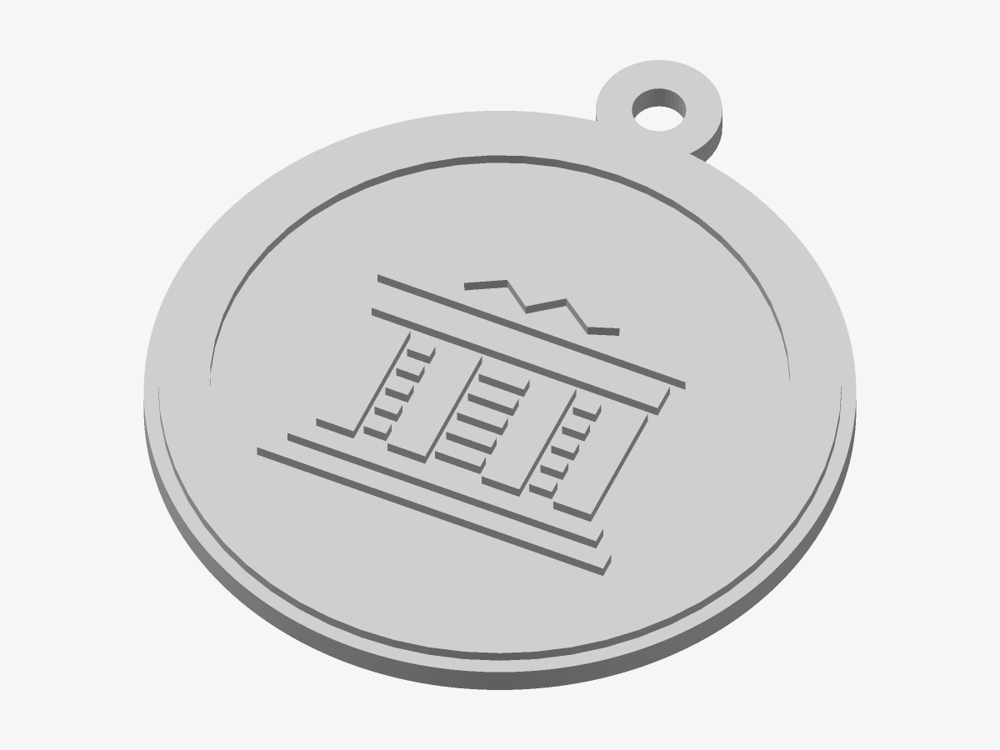

# The Olympus — Token

The seal raised on a small disc with a keyring lug — a key fob, a bag tag, a cable tag.

*Preview rendered from the mesh itself.*

| | |
|---|---|
| Size | 59 × 67.1 × 3.4 mm |
| Volume | 7.9 cm³ — at most 10 g of PLA solid; much less at 15–20 % infill |
| Mark prints from | Ø 56 mm on a 0.4 mm nozzle |

## Parameters

| Parameter | Value | |
|---|---|---|
| Diameter | 59 mm | Diameter of the disc (the lug adds to the height). |
| Flange | 1.2 mm | Plate left around the seal’s ring. |
| Disc thickness | 2.4 mm | Thickness of the disc and lug. |
| Relief height | 1 mm | How far the seal stands proud. |
| Keyring hole | 4.5 mm | Diameter of the hole in the lug. |

## Files

- `the-olympus-master-token.stl` — the solid, ready to slice
- `the-olympus-master-token.3mf` — the same solid, in 3MF
- `the-olympus-master-token.scad` — parametric source for OpenSCAD, reading `the-olympus-master-seal.svg`

## Validation

- **token**: valid — 2,008 triangles, closed and manifold (0 open or doubled edges), 0 degenerate triangles, no self-intersection (0 overlapping layers), volume 7.87 cm³ as designed.

## Printing

- Print flat on the bed, design facing up. No supports needed.
- Layer height 0.2 mm or finer; heights that are multiples of it come out exact.
- A tough filament (PETG) wears better on a keyring than PLA.
