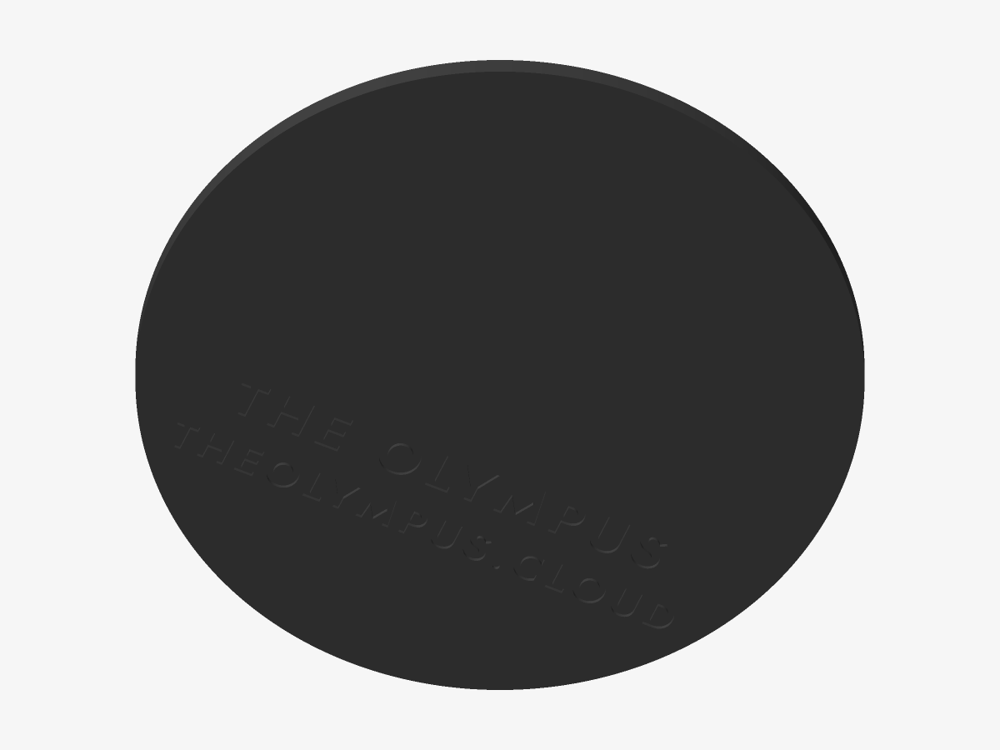

# The Olympus — Two-colour medallion

Plate and relief as separate parts — for a filament change at the relief, or a multi-material printer.

*Preview rendered from the mesh itself.*

*The back: the inscription.*

| | |
|---|---|
| Size | 100 × 100 × 4.2 mm |
| Volume | 27.3 cm³ |
| Filament | ≈ 17 g, 5.6 m of 1.75 mm at 15 % infill (an estimate) |
| Design prints from | Ø 67 mm on a 0.4 mm nozzle |

## Parameters

| Parameter | Value | |
|---|---|---|
| Diameter | 100 mm | Outer diameter of the plate. |
| Flange | 1.2 mm | Plate left around the crest’s rim. |
| Plate thickness | 3 mm | The colour changes at this height. |
| Relief height | 1.2 mm | Height of the second colour. |
| Magnet pockets | 0 | Round pockets for disc magnets: hangs on a rack door, a fridge, a steel panel. Glue the magnets in after printing. |
| Magnet diameter | 10.2 mm | Pocket diameter: the magnet plus about 0.2 mm. |
| Magnet depth | 2.2 mm | Pocket depth: the magnet’s thickness plus about 0.2 mm. |
| Keyhole hanger | off | A keyhole slot to hang it on a 3.5–4 mm screw (head up to 8 mm). Needs a plate of 4.2 mm or more. |
| Back inscription | on | The name and theolympus.cloud, engraved mirrored on the back so it reads when turned over. |

## Files

- `the-olympus-master-two-colour-plate.stl` — the plate
- `the-olympus-master-two-colour-relief.stl` — the relief
- `the-olympus-master-two-colour.3mf` — both parts as one object, each ready for its own filament
- `the-olympus-master-two-colour.scad` — parametric source for OpenSCAD

## Validation

- **plate**: valid — 9,414 triangles, closed and manifold (0 open or doubled edges), 0 degenerate triangles, no self-intersection (0 overlapping layers), volume 23.42 cm³ as designed.
- **relief**: valid — 20,124 triangles, closed and manifold (0 open or doubled edges), 0 degenerate triangles, no self-intersection (0 overlapping layers), volume 3.89 cm³ as designed.

## Printing

- Print flat on the bed, design facing up. No supports needed.
- Layers of 0.2 mm: the heights below are whole numbers of layers unless noted.
- The inscription on the back (The Olympus · theolympus.cloud) is cut 0.6 mm deep into the first layers; it reads when the piece is turned over.
- One printer, two filaments: change filament at layer 16 (z = 3.00 mm, assuming 0.2 mm layers throughout). Multi-material: load the 3MF and give each part its filament.
- Thickest point 4.2 mm — the desk stand’s slot should match.
