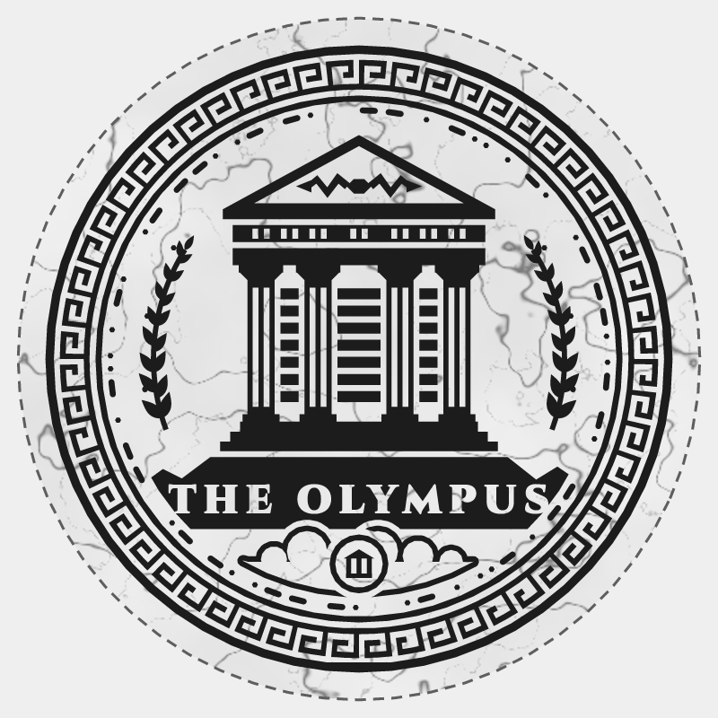

# The Olympus — sticker, crest, white marble

| | |
|---|---|
| Cut size | 75 mm (longest side) |
| File size | 79.0 × 79.0 mm, bleed included |
| Substrate | white vinyl |
| On a A4 sheet | 6 |

A printed white-marble ground with gray veining — a decorative edition.

## Files

- `the-olympus-master-sticker-crest-marble-light.pdf`, `the-olympus-master-sticker-crest-marble-light.svg` — production file, layers Bleed / Artwork / White / CutContour
- `the-olympus-master-sticker-crest-marble-light-cutline.svg` — the cut path alone
- `the-olympus-master-sticker-crest-marble-light-a4-sheet.pdf` — 6 on a A4 sheet

## Notes

- Cut: 75 × 75 mm, on its own layer as the spot colour “CutContour” (0.25 pt). Some providers want it in 100 % magenta: recolour that one layer.
- Substrate: white vinyl. The ground runs 2 mm past the cut (bleed) so no white edge shows.
- The design keeps at least 3 mm inside the cut. Edition: print — chosen for lines of 0.15 mm or more.
- Confirm bleed, cut tolerance and the finest printable line with your print provider.
